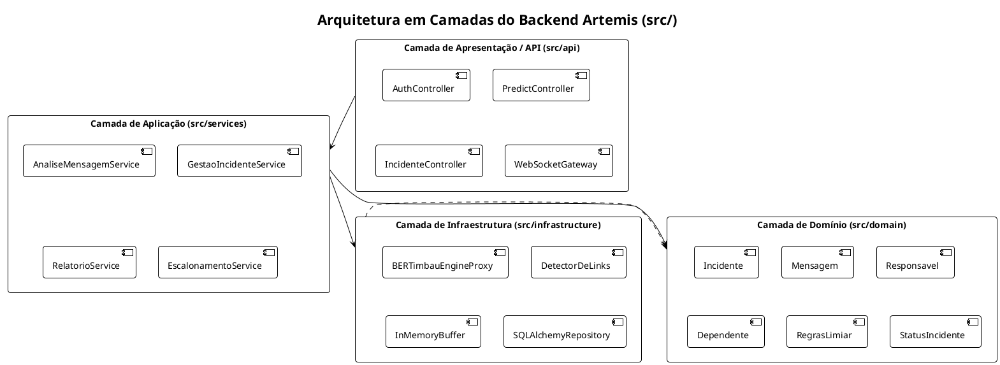

# Arquitetura de Software: Project Artemis

> **Sistema de Controle Parental Inteligente com Detecção de Ciberbullying via BERTimbau**  
> **Referência Metodológica:** Prof. Marco Tulio Valente — *Engenharia de Software Moderna* (Capítulo 7 – Arquitetura de Software)  
> **Fonte de Verdade:** `.agents/regras-de-negocio.md` (regras) e `.agents/contrato-api.md` (API); demais specs em `.agents/`  
> **Modelo Neural:** BERTimbau (`GuilhermeLA/modelo-tcc-final` binário em CPU)

---

## 1. Diagnóstico de Requisitos Não-Funcionais e Contexto

A arquitetura do **Project Artemis** foi desenhada para viabilizar inferência de Deep Learning (Transformers) em ambiente CPU com baixa latência, integridade probatória de mensagens e entrega de alertas parentais em tempo real via WebSocket.

### 1.1. Mapeamento de Atributos de Qualidade (RNF)

| RNF ID | Categoria | Métrica / Restrição Arquitetural | Impacto na Decisão Arquitetural |
| :--- | :--- | :--- | :--- |
| **RNF-11** | **Desempenho / CPU** | Latência p95 $\le$ 350ms em CPU para predição individual (meta não validada formalmente). | Carregamento Lazy Proxy dos pesos do BERTimbau e normalização de texto direta via tokenizer. |
| **RNF-02** | **Tempo de Notificação** | Alerta parental entregue em $\le$ 2,0s via WebSocket no app aberto (meta não medida formalmente). | Disparo orientado a eventos com padrão Observer em memória para comunicação imediata de incidentes críticos. |
| **RNF-06** | **Segurança** | Senhas com hash forte (Argon2id/bcrypt) e rotas da API protegidas por JWT. | Autenticação stateless na API com emissão de Bearer Tokens e validação de permissões do guardião. |
| **RNF-07** | **Integridade Probatória** | Preservação de cadeia de custódia com hash SHA-256. | Cálculo do hash no simulador via Web Crypto API, validação no backend e registro no relatório PDF. |
| **RNF-08** | **Privacidade / LGPD** | Não persistência de conversas comuns e suporte à exclusão real. | Persistência pós-classificação: mensagens seguras não são gravadas (só ficam no buffer volátil de 3 mensagens); exclusão real pelo responsável primário. |
| **RNF-09** | **Acessibilidade** | Padrões visuais do App Flutter | Contraste mínimo 4.5:1 nas telas do MVP. Conformidade completa com WCAG 2.1 AA e modo de acessibilidade (UC-15) são trabalho futuro. |

---

## 2. Topologia do Sistema e Componentes

```
+-----------------------------------------------------------------------------------+
|                               TOPOLOGIA GERAL                                     |
|                                                                                   |
|  [ Simulador de Chat Web ]                                [ App Flutter Android ] |
|  - HTML5 / CSS3 / Vanilla JS                               - Mobile (Emulador/APK) |
|  - Roda na porta 3000 (localhost:3000)                     - Conecta em 10.0.2.2   |
|  - Calcula SHA-256 no browser                              - Alertas via WebSocket |
|  - Envia HTTP POST /api/v1/predict                         - Gestão de Incidentes  |
|               |                                                       ^           |
|               | (HTTP REST)                               (WebSocket) |           |
|               v                                                       |           |
|  +--------------------------------------------------------------------+--------+  |
|  |                 BACKEND FASTAPI (Monólito Modular / Clean)                  |  |
|  |                 Porta 8000 (0.0.0.0:8000)                                   |  |
|  |                                                                             |  |
|  |  [ PredictController ] --------> [ AnaliseMensagemService ]                |  |
|  |                                     |                  |                    |  |
|  |                 +-------------------+                  +----------+         |  |
|  |                 v                                                 v         |  |
|  |   [ BERTimbauEngineProxy ] (CPU)                      [ Observer Notifier ] |  |
|  |   - Tokenizer WordPiece                               - WebSocket Gateway   |  |
|  |   - Pesos carregados de /models                       - Escalonamento       |  |
|  |   - DetectorDeLinks (has_link)                                              |  |
|  |                 |                                                           |  |
|  |                 v                                                           |  |
|  |   [ IncidenteRepository ] (SQLite: /app/data/artemis.db)                    |  |
|  |   - Gravação apenas de incidentes >= L ou has_link=true e buffer de contexto|  |
|  +-----------------------------------------------------------------------------+  |
|                                        ^                                          |
|                                        | Volume compartilhado /models             |
|                                        v                                          |
|                        [ Scripts / JupyterLab (Opcional) ]                        |
|                        - Profile docker-compose: training                         |
|                        - Porta 8888                                               |
+-----------------------------------------------------------------------------------+
```

---

## 3. Contrato Oficial da API (`POST /api/v1/predict`)

### 3.1. Especificação de Request e Response (Decisão 22)

```json
// Request: POST /api/v1/predict
{
  "text": "Você é um inútil, ninguém gosta de você",
  "message_hash": "a591a6d40bf420404a011733cfb7b190d62c65bf0bcda32b57b277d9ad9f146e",
  "dependent_id": "dep-001",
  "context_metadata": {
    "conversation_id": "conv-game-88",
    "room_type": "jogo",
    "sender_id": "user-adversario-09",
    "is_from_minor": false,
    "is_direct": true,
    "timestamp": "2026-10-07T14:30:00Z"
  }
}

// Response: 200 OK
{
  "label": "nocivo",
  "category": "CIBERBULLYING",
  "confidence": 0.93,
  "has_link": false,
  "action_required": "ALERT_PARENT_CRITICAL",
  "detected_role": "VITIMA",
  "sha256_match": true,
  "incident_id": "inc-9876",
  "model_version": "GuilhermeLA/modelo-tcc-final",
  "inference_time_ms": 142.5
}
```

### 3.2. Tabela de Tratamento de Respostas e Erros HTTP
| Situação | Código HTTP | Comportamento |
| :--- | :--- | :--- |
| Predição bem-sucedida | 200 OK | Retorna o payload oficial completo. |
| Texto vazio ou apenas espaços | 400 Bad Request | Rejeita requisição com detalhe explicativo. |
| Campo obrigatório ausente ou tipo inválido | 422 Unprocessable Entity | Validação automática Pydantic. |
| `dependent_id` inexistente no banco | 404 Not Found | Impede processamento de dependente não cadastrado. |
| `sha256_match = false` | 200 OK | Processa predição; se virar incidente, grava `integridade_divergente = true`. |

---

## 4. Estrutura Modular em Camadas (`backend/src`)



---

## 5. Orquestração de Deploy (`docker-compose.yml`)

```yaml
version: '3.8'

services:
  backend:
    build: ./backend
    container_name: artemis_backend
    ports:
      - "8000:8000"
    environment:
      - APP_ENV=production
      - MODEL_DIR=/models/modelo_tcc_final
      - DATABASE_URL=sqlite:////app/data/artemis.db
    volumes:
      - ./models:/models:ro
      - ./backend/data:/app/data
    restart: unless-stopped

  simulator:
    build: ./simulator
    container_name: artemis_simulator
    ports:
      - "3000:80"
    restart: unless-stopped

  scripts:
    build: ./scripts
    container_name: artemis_scripts
    profiles: ["training"]
    ports:
      - "8888:8888"
    volumes:
      - ./models:/models
      - ./scripts/datasets:/app/datasets
```
