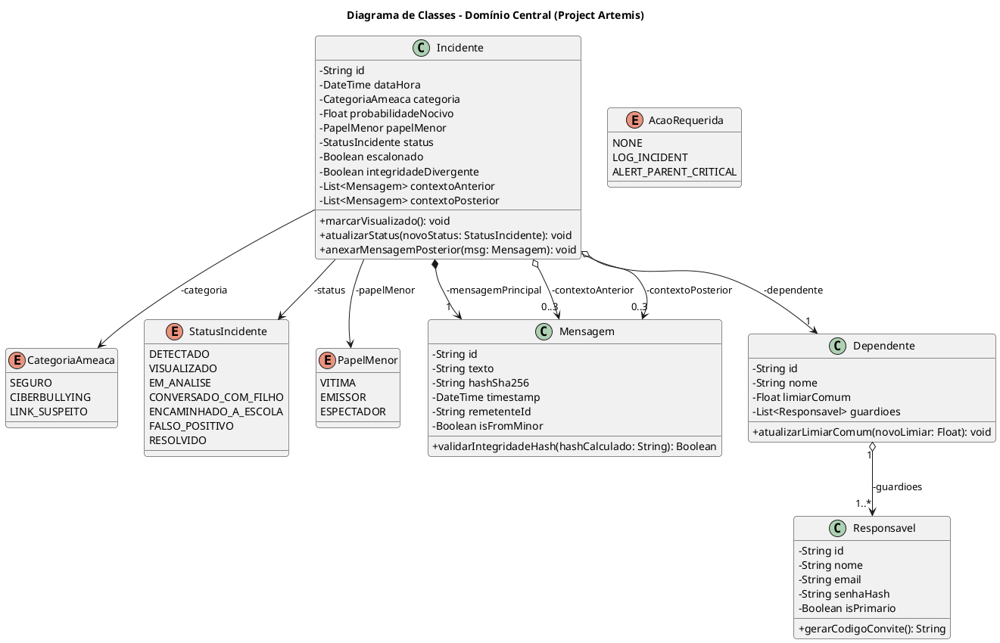
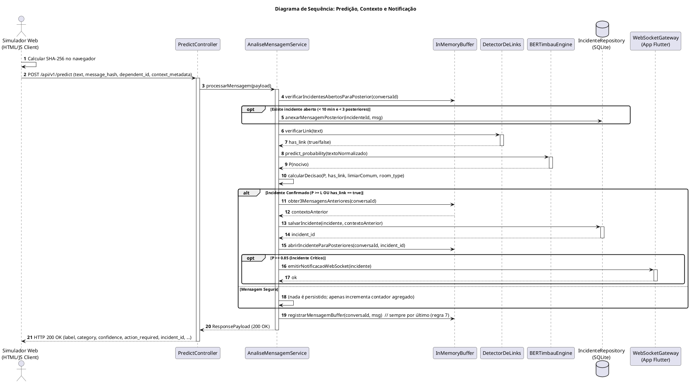
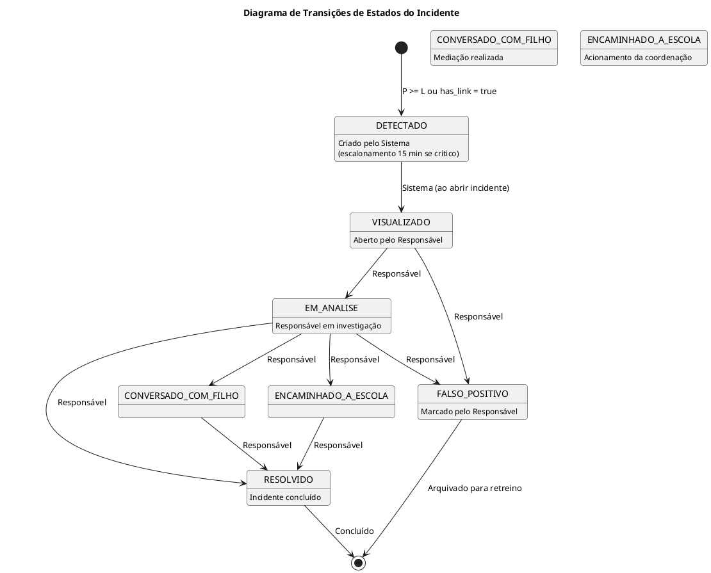

# Modelagem UML como Esboços (Sketches): Project Artemis

> **Sistema de Controle Parental Inteligente com Detecção de Ciberbullying via BERTimbau**  
> **Referência Metodológica:** Prof. Marco Tulio Valente — *Engenharia de Software Moderna* (Capítulo 4 – Modelos)  

> **Abordagem:** Esboços Ágeis (Regra dos 20/80, Foco em Decisões de Design e Eliminação de BDUF)

---

## 1. Visão Arquitetural de Alto Nível (Diagrama de Pacotes)

```plantuml
@startuml
!theme plain
skinparam packageStyle rectangle
skinparam shadowing false
skinparam roundcorner 8

title Diagrama de Pacotes - Arquitetura em Camadas (Project Artemis)

package "Apresentação & Clientes" as CamadaApresentacao {
  [SimuladorChatWeb]
  [AppParentalFlutter]
}

package "Aplicação & Orquestração" as CamadaAplicacao {
  [PredictController]
  [AuthController]
  [AnaliseMensagemService]
  [GestaoIncidenteService]
  [EscalonamentoService]
  [RelatorioIncidenteService]
}

package "Domínio Central" as CamadaDominio {
  [Incidente]
  [Mensagem]
  [Responsavel]
  [Dependente]
  enum CategoriaAmeaca
  enum StatusIncidente
  enum PapelMenor
  enum AcaoRequerida
}

package "Infraestrutura & Persistência" as CamadaInfra {
  [BERTimbauNeuralEngine]
  [DetectorDeLinks]
  [WebSocketNotificationGateway]
  [IncidenteRepository]
  [InMemoryMessageBuffer]
}

' Relacionamentos
[SimuladorChatWeb] --> [PredictController] : HTTP POST /api/v1/predict
[AppParentalFlutter] --> [AuthController] : Login JWT
[AppParentalFlutter] --> [GestaoIncidenteService] : HTTP REST
[AppParentalFlutter] <.. [WebSocketNotificationGateway] : Notificações em Tempo Real

[PredictController] --> [AnaliseMensagemService]
[AnaliseMensagemService] --> [BERTimbauNeuralEngine] : <<use>>
[AnaliseMensagemService] --> [DetectorDeLinks] : <<use>>
[AnaliseMensagemService] --> [InMemoryMessageBuffer] : <<use>>
[AnaliseMensagemService] --> [Incidente] : Cria se incidente
[AnaliseMensagemService] --> [IncidenteRepository] : Persiste incidente
[AnaliseMensagemService] --> [WebSocketNotificationGateway] : Notifica se P >= 0.85

[GestaoIncidenteService] --> [IncidenteRepository]
[EscalonamentoService] --> [IncidenteRepository]
[EscalonamentoService] --> [WebSocketNotificationGateway]
[RelatorioIncidenteService] --> [Incidente]

@enduml
```

---

## 2. Diagrama de Classes do Domínio Central (PlantUML)



---

## 3. Diagrama de Sequência: Análise e Notificação (PlantUML)

Alinhado ao contrato oficial da API (Decisão 22) e ao anexo de mensagens posteriores (Decisão 27).



---

## 4. Diagrama de Estados do Incidente (PlantUML)

Mapeia estritamente a tabela oficial de transições de status da Decisão 31.


