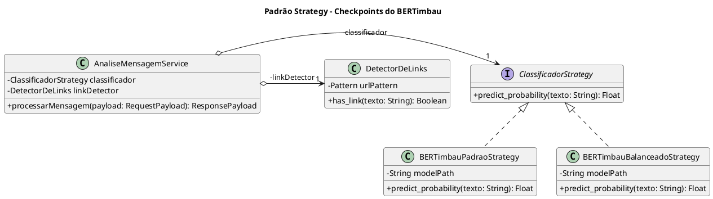
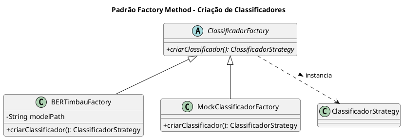
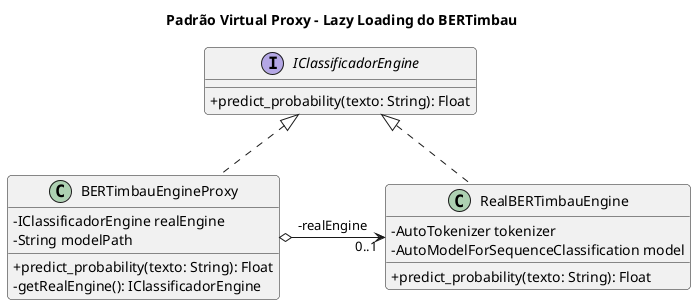
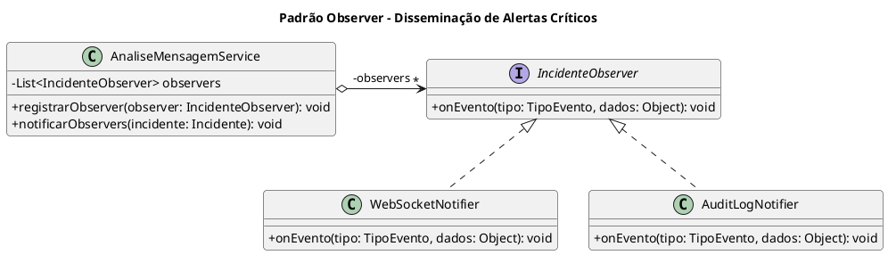
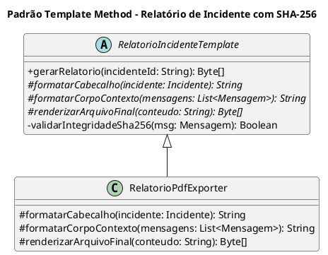

# Padrões de Projeto de Software (Design Patterns): Project Artemis

> **Sistema de Controle Parental Inteligente com Detecção de Ciberbullying via BERTimbau**  
> **Referência Metodológica:** Prof. Marco Tulio Valente — *Engenharia de Software Moderna* (Capítulo 6 – Padrões de Projeto)  
> **Princípios Arquiteturais:** *Design for Change*, SOLID (OCP, DIP, SRP), Composição sobre Herança e Prevenção do Anti-Pattern da Paternite (*Anti-Overengineering*)

---

## 1. Diagnóstico Estratégico de Variabilidade & Padrões Selecionados

A adoção de padrões de projeto no **Project Artemis** é orientada a isolar eixos de variabilidade reais e necessários para a execução eficiente em CPU e desacoplamento do backend FastAPI e do App Flutter.

| Eixo de Variabilidade | Problema / Necessidade de Design | Padrão GoF | Categoria | Justificativa Técnica (Marco Tulio Valente) |
| :--- | :--- | :--- | :--- | :--- |
| **1. Checkpoints do Modelo BERTimbau** | Alternar entre o checkpoint padrão e o checkpoint rebalanceado do BERTimbau em tempo de execução. | **Strategy** | Comportamental | Encapsula os checkpoints do BERTimbau sob a interface `ClassificadorStrategy`, mantendo o código aberto para novos ajustes sem modificar os serviços de domínio (OCP). |
| **2. Instanciação e Modos de Execução** | Criação do modelo BERTimbau real versus Mock para testes de integração rápidos em CI/CD sem dependência de pesos pesados. | **Factory Method** | Criacional | Centraliza a criação do classificador via `ClassificadorFactory`, desacoplando os serviços de negócio da inicialização de tensores PyTorch. |
| **3. Carregamento de Pesos do Modelo** | O modelo BERTimbau possui ~440MB e não deve bloquear o boot inicial nem sobrecarregar execuções de testes unitários. | **Virtual Proxy (Lazy Loading)** | Estrutural | Posterga a carga dos tensores do disco (`/models`) para a primeira inferência real, mantendo o tempo de inicialização da API quase instantâneo. |
| **4. Notificação de Incidentes Críticos** | Despacho em tempo real para múltiplos canais (WebSocket para o App Flutter, Log de Auditoria e Escalonamento). | **Observer (Pub/Sub)** | Comportamental | Desacopla `AnaliseMensagemService` da infraestrutura de sockets e entrega em tempo real, permitindo adicionar novos observadores sem alterar a triagem. |
| **5. Geração de Relatórios de Incidente** | Estrutura algorítmica padronizada para consolidar contexto, validar hash SHA-256 e gerar o arquivo final. | **Template Method** | Comportamental | Define a sequência invariante de auditoria na classe abstrata, permitindo variações na renderização final (PDF, JSON). |

> **Nota Arquitetural sobre Detecção de Links:** O componente `DetectorDeLinks` atua como um componente auxiliar determinístico que emite um sinal booleano (`has_link`), executado em paralelo com o classificador neural. Por não ser uma alternativa de classificação, não integra a hierarquia Strategy (Decisão 25).

---

## 2. Catálogo Detalhado dos Padrões de Projeto

---

### 2.1. Padrão Comportamental: Strategy (Checkpoints do BERTimbau)

#### 🎯 Contexto e Intenção
Permite alternar entre diferentes checkpoints do modelo neural binário:
1. **BERTimbauPadraoStrategy:** Checkpoint padrão fine-tuned com balanceamento original.
2. **BERTimbauBalanceadoStrategy:** Checkpoint com pesos calibrados para maior revocação.

#### 📐 Diagrama de Classes (PlantUML)


#### 💻 Implementação em Python (FastAPI / PyTorch)
```python
from abc import ABC, abstractmethod
import re

class ClassificadorStrategy(ABC):
    @abstractmethod
    def predict_probability(self, texto: str) -> float:
        """Retorna a probabilidade P(nocivo) entre 0.0 e 1.0"""
        pass

class DetectorDeLinks:
    def __init__(self):
        self.url_regex = re.compile(r"https?://\S+|www\.\S+", re.IGNORECASE)

    def has_link(self, texto: str) -> bool:
        return bool(self.url_regex.search(texto))
```

---

### 2.2. Padrão Criacional: Factory Method (Instanciação de Classificadores)

#### 🎯 Contexto e Intenção
Isola a criação de instâncias de PyTorch, permitindo alternar facilmente para instâncias mockadas durante a execução de testes automatizados locais.



#### 💻 Implementação em Python
```python
import os
from abc import ABC, abstractmethod

class ClassificadorFactory(ABC):
    @abstractmethod
    def criar_classificador(self) -> ClassificadorStrategy:
        pass

class BERTimbauFactory(ClassificadorFactory):
    def __init__(self, model_dir: str = "/models/modelo_tcc_final"):
        self.model_dir = model_dir

    def criar_classificador(self) -> ClassificadorStrategy:
        from src.infrastructure.bertimbau_engine import BERTimbauEngineProxy
        return BERTimbauEngineProxy(model_path=self.model_dir)

class MockClassificadorFactory(ClassificadorFactory):
    def criar_classificador(self) -> ClassificadorStrategy:
        class MockStrategy(ClassificadorStrategy):
            def predict_probability(self, texto: str) -> float:
                if "idiota" in texto.lower() or "morra" in texto.lower():
                    return 0.92
                return 0.05
        return MockStrategy()

def get_classificador_factory() -> ClassificadorFactory:
    env = os.getenv("APP_ENV", "production")
    if env == "testing":
        return MockClassificadorFactory()
    return BERTimbauFactory()
```

---

### 2.3. Padrão Estrutural: Virtual Proxy (Lazy Loading de Pesos do Modelo)

#### 🎯 Contexto e Intenção
Posterga a carga dos tensores do BERTimbau para a primeira inferência real.



---

### 2.4. Padrão Comportamental: Observer (Notificação Desacoplada)

#### 🎯 Contexto e Intenção
Ao confirmar um incidente crítico ($P(\text{nocivo}) \ge 0.85$), o serviço notifica os observadores registrados em memória, transmitindo o alerta em tempo real via WebSocket para o App Flutter e registrando o log de auditoria.



---

### 2.5. Padrão Comportamental: Template Method (Geração de Relatórios de Incidente)

#### 🎯 Contexto e Intenção
Define a sequência invariante de auditoria:
1. Extração do incidente e histórico de mensagens do banco.
2. Verificação de integridade do hash SHA-256 de origem.
3. Formatação dos metadados e data/hora UTC.
4. Renderização do arquivo final em PDF.


