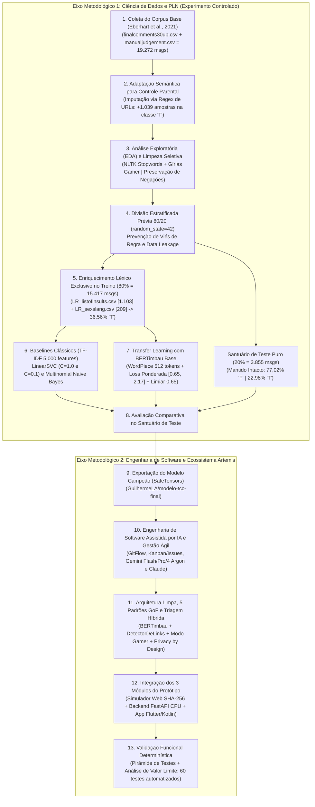

# Procedimentos Metodológicos e Desenvolvimento — Trabalho de Conclusão de Curso (TCC)

> **Título do Projeto:** Inteligência Artificial Aplicada à Detecção de Mensagens Nocivas em Ambientes Virtuais de Jogos (*Project Artemis*)  
> **Instituição:** Universidade Estadual de Montes Claros (Unimontes)  
> **Estrutura do Documento:** Este documento consolida, em linguagem acadêmica formal e com fundamentação bibliográfica completa (padrão ABNT), as seções de **Procedimentos Metodológicos**, **Desenvolvimento (Engenharia de Dados, Aprendizado de Máquina e Engenharia de Software)** e **Referências Bibliográficas** do Trabalho de Conclusão de Curso.

---

# PARTE I — PROCEDIMENTOS METODOLÓGICOS

## 1. Caracterização e Desenho Geral da Pesquisa

Os procedimentos metodológicos compreendem o conjunto sistematizado de etapas científicas, escolhas técnicas e protocolos experimentais adotados para investigar o problema de pesquisa, garantindo a validade interna, a rastreabilidade empírica e a reprodutibilidade dos resultados (GIL, 2019; WAZLAWICK, 2020). Neste trabalho, investiga-se o problema da detecção automatizada de ciberbullying, assédio moral e vetores de aliciamento infantil (*online grooming*) em chats de jogos eletrônicos em língua portuguesa do Brasil, conciliando alta sensibilidade preditiva com preservação da privacidade infantojuvenil.

Para conduzir a investigação, adotou-se como paradigma condutor a **Design Science Research (DSR)** (HEVNER et al., 2004; PEFFERS et al., 2007). Na Ciência da Computação e em Sistemas de Informação, a DSR fundamenta pesquisas cujo objetivo central consiste na concepção, construção rigorosa e avaliação empírica de artefatos tecnológicos inovadores — tais como modelos algorítmicos, arquiteturas e sistemas de software — projetados para resolver problemas práticos de relevância social.

Sob a ótica da taxonomia clássica da metodologia científica (GIL, 2019; PRODANOV; FREITAS, 2013; WAZLAWICK, 2020), a presente pesquisa classifica-se conforme sintetizado no **Quadro 1** e detalhado nas subseções subsequentes.

**Quadro 1 — Síntese da Classificação Metodológica da Pesquisa**

| Dimensão Metodológica             | Classificação Adotada                                                             | Aplicação Direta no Trabalho (*Project Artemis*)                                                                                                                                                                                                                     |
| :-------------------------------- | :-------------------------------------------------------------------------------- | :------------------------------------------------------------------------------------------------------------------------------------------------------------------------------------------------------------------------------------------------------------------- |
| **1. Natureza da Pesquisa**       | **Pesquisa Aplicada**                                                             | Aplicação prática de Processamento de Linguagem Natural (PLN) e Redes Neurais *Transformers* na construção de um sistema de controle parental funcional.                                                                                                             |
| **2. Objetivos da Pesquisa**      | **Exploratória e Descritiva** *(com viés explicativo)*                            | Exploração das especificidades do dialeto gamer em português, descrição estatística do corpus e das métricas preditivas, e explicação dos fatores geradores de falsos positivos e falsos negativos.                                                                  |
| **3. Abordagem do Problema**      | **Quali-Quantitativa (Mista)**                                                    | **Quantitativa** na mensuração estatística dos classificadores (Acurácia, Precisão, Revocação, F1-Score, TF-IDF e BVA) e **Qualitativa** na análise pragmática de gírias competitivas (*Modo Gamer*), partículas de negação e proteção jurídica do menor (LGPD/ECA). |
| **4. Procedimentos Técnicos**     | **Bibliográfica, Documental, Experimental e Design Science**                      | Revisão da literatura de PLN e Engenharia de Software, análise normativa da LGPD e do ECA, experimentação controlada de algoritmos de Aprendizado de Máquina e implementação de protótipo distribuído.                                                               |
| **5. Método de Análise de Dados** | **Estatística Computacional, Matriz de Confusão e Análise de Valor Limite (BVA)** | Avaliação preditiva em partição de teste isolada (*hold-out* estratificado de $20\%$, livre de *data leakage*) e validação determinística de software via suíte de $60$ testes automatizados.                                                                        |

*Fonte: Elaborado pelo autor (2026).*

---

### 1.1. Quanto à Natureza da Pesquisa
Quanto à sua natureza, o estudo classifica-se como uma **Pesquisa Aplicada** (PRODANOV; FREITAS, 2013). Enquanto a pesquisa básica visa à ampliação do conhecimento teórico sem finalidade de utilização imediata, a pesquisa aplicada concentra-se na geração de soluções tecnológicas para problemas concretos. Neste trabalho, os fundamentos teóricos do Aprendizado Profundo (*Deep Learning*) e da transferência de aprendizado (*Transfer Learning*) com o modelo **BERTimbau** (SOUZA; NOGUEIRA; LOTUFO, 2020) são aplicados diretamente para mitigar a exposição de crianças e adolescentes a agressões verbais e links maliciosos em ambientes virtuais de jogos, materializando-se no ecossistema computacional denominado **Project Artemis**.

### 1.2. Quanto aos Objetivos da Pesquisa
Em relação aos seus objetivos gerais, a pesquisa assume caráter **Exploratório e Descritivo**, complementado por análises explicativas (GIL, 2019):
1. **Etapa Exploratória:** Justifica-se pela carência de estudos científicos e soluções abertas em língua portuguesa do Brasil que tratem simultaneamente a detecção de toxicidade em chats de jogos eletrônicos, o tratamento do vocabulário competitivo informal (*trash talk*) e a conformidade estrita com o princípio de *Privacy by Design* (CAVOUKIAN, 2009). Essa etapa compreendeu a investigação do corpus base de Eberhart, Ignaczak e Martins (2021), a análise de léxicos de insultos e gírias sexuais e a formulação de heurísticas para detecção de links de aliciamento (*grooming*).
2. **Etapa Descritiva e Explicativa:** Consiste no mapeamento estatístico das propriedades do corpus textual ($19.272$ mensagens, distribuição de classes, quartis de comprimento de sentenças e frequência de *n-gramas*) e na descrição comparativa do desempenho preditivo entre algoritmos clássicos de Aprendizado de Máquina (*Support Vector Machines* e *Multinomial Naive Bayes*) e arquiteturas baseadas em *Transformers* (*BERTimbau*). O caráter explicativo evidencia-se na análise dos hiperparâmetros de regularização ($C$), da função de perda ponderada (*Weighted Cross-Entropy Loss*) e do ajuste de limiar probabilístico ($\tau = 0,65$), demonstrando matematicamente por que modelos baseados em frequência de termos (*Bag-of-Words*) falham diante da polissemia do dialeto gamer.

### 1.3. Quanto à Abordagem do Problema
A pesquisa adota uma abordagem **Quali-Quantitativa (Mista)** (CRESWELL; CRESWELL, 2021), reconhecendo que a moderação de conteúdo voltada à proteção infantil exige tanto rigor estatístico quanto sensibilidade semântica ao contexto conversacional:
* **Abordagem Quantitativa:** Expressa-se na manipulação matricial e avaliação estatística do corpus de $19.272$ mensagens, na vetorização TF-IDF de $5.000$ atributos, no cálculo de pesos inversamente proporcionais às classes ($w_0 = 0,65$ e $w_1 = 2,17$), na mensuração objetiva via Matriz de Confusão (Verdadeiros Positivos, Falsos Positivos, Verdadeiros Negativos e Falsos Negativos), Acurácia, Precisão, Revocação (*Recall*) e *F1-Score* (POWERS, 2011), e nos testes determinísticos de Análise de Valor Limite (*Boundary Value Analysis* — BVA) sobre as fronteiras de decisão do sistema ($0,50$; $0,65$; $0,70$ e $0,85$).
* **Abordagem Qualitativa:** Manifesta-se na interpretação linguística e pragmática dos fenômenos estudados, tais como: (i) a reclassificação semântica de URLs externas sob a ótica da proteção de menores; (ii) a preservação deliberada de partículas de negação (*"não"*, *"nunca"*, *"jamais"*) durante o pré-processamento para evitar a inversão de polaridade em frases de recusa ou autodefesa da criança; (iii) a diferenciação entre hostilidade lúdica dirigida ao jogo e agressão interpessoal dirigida ao menor (que fundamentou a criação do **Modo Gamer**); e (iv) a modelagem ética de retenção mínima de dados pessoais sensíveis.

### 1.4. Quanto aos Procedimentos Técnicos e Métodos de Coleta
O percurso metodológico articulou quatro procedimentos técnicos complementares:
1. **Pesquisa Bibliográfica:** Fundamentada em publicações científicas indexadas e obras de referência nas áreas de Processamento de Linguagem Natural e Aprendizado de Máquina (SALTON; BUCKLEY, 1988; CORTES; VAPNIK, 1995; MCCALLUM; NIGAM, 1998; VASWANI et al., 2017; DEVLIN et al., 2019; SOUZA; NOGUEIRA; LOTUFO, 2020; EBERHART; IGNACZAK; MARTINS, 2021; GÉRON, 2022; JURAFSKY; MARTIN, 2024) e de Engenharia de Software (GAMMA et al., 1995; COCKBURN, 2001; MYERS; BADGETT; SANDLER, 2011; MARTIN, 2017; SOMMERVILLE, 2019; VALENTE, 2020).
2. **Pesquisa Documental:** Análise de fontes primárias normativas e bases de dados abertas, abrangendo o **Estatuto da Criança e do Adolescente — ECA (Lei nº 8.069/1990)** (BRASIL, 1990), a **Lei Geral de Proteção de Dados Pessoais — LGPD (Lei nº 13.709/2018, em especial o Art. 14 sobre o tratamento de dados pessoais de crianças e adolescentes)** (BRASIL, 2018) e os artefatos de dados públicos disponibilizados por Eberhart, Ignaczak e Martins (2021).
3. **Pesquisa Experimental:** Execução de experimentos controlados de treinamento e validação de modelos de Aprendizado de Máquina em ambiente computacional isolado (JupyterLab com aceleração por GPU), mantendo constante o conjunto de teste puro (*hold-out* de $20\%$) e variando sistematicamente os paradigmas algorítmicos, técnicas de representação textual (TF-IDF *vs.* *WordPiece Embeddings*), hiperparâmetros de margem, pesos de função de perda e limiares de corte (WAZLAWICK, 2020).
4. **Construção de Artefato via *Design Science Research*:** Desenvolvimento iterativo e integração fim a fim do protótipo **Project Artemis**, composto por um Simulador de Chat Web com criptografia no cliente, uma API Backend REST/WebSocket em Python/FastAPI com inferência neural em CPU e um Aplicativo Móvel Android em Flutter/Kotlin.

---

# PARTE II — DESENVOLVIMENTO

O desenvolvimento deste trabalho foi estruturado em duas grandes vertentes interdependentes: (i) **Engenharia de Dados, Pré-processamento e Modelagem de Inteligência Artificial**, na qual se realizou a preparação do corpus, o treinamento comparativo de algoritmos e o ajuste fino do modelo BERTimbau; e (ii) **Engenharia de Software e Construção do Ecossistema *Project Artemis***, abrangendo a arquitetura, os padrões de projeto, o fluxo de desenvolvimento assistido por IA generativa e a implementação dos módulos cliente-servidor.

---

## 2. Engenharia de Dados, Pré-processamento e Adaptação do Corpus

### 2.1. Coleta da Base de Dados Primária e Unificação Relacional
A construção de classificadores supervisionados de texto em língua portuguesa esbarra historicamente na escassez de *corpora* públicos rotulados para o fenômeno do ciberbullying. Para superar essa limitação com respaldo científico, adotou-se como base primária e linha de referência (*baseline*) o conjunto de dados construído e validado por **Eberhart, Ignaczak e Martins (2021)** no estudo *"Text Mining for Cyberbullying Detection: a Brazilian Portuguese Evaluation"*, publicado nos anais do *Symposium in Information and Human Language Technology (STIL/SBC)*.

O repositório bruto (`scripts/datasets/`) é constituído por quatro artefatos tabulares em formato CSV:
1. **`finalcomments30up.csv`:** Contém **$19.272$ comentários e postagens** reais em português brasileiro coletados da plataforma *Reddit*, distribuídos nos atributos `id` (identificador numérico único), `texto` (conteúdo textual integral da mensagem), `autor` (pseudônimo do usuário) e `comunidade` (*subreddit* de origem).
2. **`manualjudgement.csv`:** Contém **$28.855$ avaliações manuais** realizadas por anotadores humanos, associando o identificador da mensagem (`id`) ao rótulo binário de classe (`label`), onde `'T'` (*True*) indica a presença de conteúdo tóxico/ciberbullying e `'F'` (*False*) indica mensagem normal/segura.
3. **`LR_listofinsults.csv`:** Recurso léxico complementar composto por **$1.103$ palavras e expressões de insulto**, xingamentos e termos pejorativos em língua portuguesa.
4. **`LR_sexslang.csv`:** Recurso léxico composto por **$209$ termos e gírias de conotação sexual** explícita.

No primeiro estágio do pipeline (`scripts/datasets/databaseTransformation.ipynb`), executou-se a junção relacional interna (*inner join* via função `pd.merge` sobre a chave primária `id`) entre os arquivos `finalcomments30up.csv` e `manualjudgement.csv`. Essa operação consolidou um conjunto íntegro de **$19.272$ mensagens rotuladas**, verificando-se a ausência total de valores nulos ou registros órfãos (`0` valores ausentes em todas as cinco colunas). Na distribuição original proveniente dos rótulos humanos de Eberhart, Ignaczak e Martins (2021), o corpus apresentava **$15.881$ mensagens seguras (`F`, $82,40\%$)** e **$3.391$ mensagens tóxicas (`T`, $17,60\%$)**.

---

### 2.2. Reclassificação Semântica para Controle Parental: A Regra de Imputação de URLs
Durante a inspeção exploratória inicial da base unificada, identificou-se uma divergência importante de domínio entre o propósito original do dataset de Eberhart, Ignaczak e Martins (2021) e os requisitos de segurança de um sistema de controle parental voltado a crianças e adolescentes. Na base original — coletada do *Reddit*, uma rede social predominantemente frequentada por adultos —, mensagens compostas exclusivamente por hiperlinks externos, incluindo links diretos para portais de conteúdo pornográfico adulto (como *Pornhub* e *SpankBang*, constatados empiricamente nos registros de `id` `70`, `71` e `72`), estavam rotuladas como não tóxicas (`label = 'F'`), uma vez que não configuravam insulto direto entre adultos naquela comunidade.

Todavia, sob a ótica da proteção integral prevista no **Estatuto da Criança e do Adolescente (Lei nº 8.069/1990)** e da literatura especializada em segurança cibernética infantil (KOWALSKI et al., 2014; WHITTLE et al., 2013), o envio de links externos em chats de jogos eletrônicos representa um dos principais vetores de:
1. **Aliciamento Infantil (*Online Grooming*):** Tentativa de migrar a conversa do chat público/monitorado do jogo para plataformas externas privadas sem moderação;
2. **Exposição Precoce a Conteúdo Impróprio:** Redirecionamento de menores para páginas de pornografia, violência extrema ou apostas; e
3. **Fraudes e *Phishing* Gamer:** Disseminação de páginas falsas prometendo moedas virtuais ou *skins* gratuitas para captura de credenciais e dados familiares.

Para adequar o corpus à realidade do controle parental, implementou-se um algoritmo de **imputação automática determinística baseada em expressão regular (Regex)** sobre a coluna `texto`:

$$\text{Regex}_{\text{URL}} = \texttt{(http|https|www|\textbackslash.com|\textbackslash.br|\textbackslash.net|\textbackslash.org|\textbackslash.gov|\textbackslash.gg|\textbackslash.me|\textbackslash.io|\textbackslash.tv)}$$

Utilizando a operação vetorizada `np.where(mascara_urls, 'T', df_consolidado['label'])`, qualquer mensagem contendo padrões de endereço eletrônico teve seu rótulo imputado como risco (`'T'`). Essa transformação reclassificou exatamente **$1.039$ mensagens** (que migraram de `'F'` para `'T'`), gerando o arquivo mestre `dataset_parental_link.csv`, cuja distribuição passou a ser de **$14.842$ mensagens seguras (`F`, $77,01\%$)** e **$4.430$ mensagens nocivas (`T`, $22,99\%$)**.

---

### 2.3. Análise Exploratória do Corpus e Higienização Textual Seletiva
No segundo notebook experimental (`scripts/datasets/DatasetAnalasys.ipynb`), conduziu-se a Análise Exploratória de Dados (*Exploratory Data Analysis* — EDA) sobre as $19.272$ mensagens do `dataset_parental_link.csv`. A análise estatística do comprimento das mensagens (em número de palavras) revelou uma média de **$29,13$ palavras** (desvio-padrão de $\pm 46,71$), valor mínimo de $1$ palavra, primeiro quartil ($Q_1 = 25\%$) de **$9$ palavras**, mediana ($Q_2 = 50\%$) de **$15$ palavras**, terceiro quartil ($Q_3 = 75\%$) de **$30$ palavras** e máximo de $829$ palavras. Tais números confirmam que $75\%$ das interações possuem até $30$ palavras, refletindo a natureza curta, rápida e fragmentada da comunicação em ambientes digitais.

Para viabilizar o treinamento dos algoritmos clássicos de Aprendizado de Máquina baseados em representação vetorial esparsa, implementou-se um pipeline sequencial de limpeza textual (`limpar_texto`), fundamentado nas boas práticas de PLN (BIRD; KLEIN; LOPER, 2009; JURAFSKY; MARTIN, 2024), mas adaptado com três decisões metodológicas específicas para o domínio de chats de jogos:

1. **Padronização de Caixa, Normalização Unicode e Limpeza Alfanumérica:**
   Todo o texto foi convertido para letras minúsculas (`lower()`) e submetido à decomposição canônica de compatibilidade Unicode (`unicodedata.normalize('NFKD', texto).encode('ASCII', 'ignore')`), removendo acentuações gráficas para unificar variações ortográficas informais (ex.: *"você"* e *"voce"*). Em seguida, aplicou-se a expressão regular `re.sub(r'[^\w\s]', '', texto)`, suprimindo pontuações, símbolos especiais e caracteres não alfanuméricos.
2. **O Problema da Inversão de Polaridade por Partículas de Negação (Decisão Crítica):**
   Listas convencionais de palavras vazias (*stopwords*), como o corpus padrão da língua portuguesa da biblioteca `NLTK` (`nltk.corpus.stopwords`), incluem advérbios de negação como *"não"*, *"nem"*, *"nunca"* e *"sem"*. Em sistemas de detecção de assédio e proteção infantil, a remoção cega dessas partículas destrói a semântica de recusa e inverte completamente a polaridade da frase: uma mensagem de autodefesa de uma criança como *"não quero jogar com você"* ou *"não mande fotos"* seria reduzida a *"quero jogar com você"* ou *"mande fotos"*. Para impedir esse erro metodológico, definiu-se explicitamente o conjunto de proteção:
   $$P_{\text{manter}} = \{\text{``não''}, \text{``nao''}, \text{``nem''}, \text{``nunca''}, \text{``jamais''}, \text{``sem''}\}$$
   Esse subconjunto foi subtraído da lista de remoção via operação de diferença de conjuntos (`stop_words_pt = stop_words_pt.difference(palavras_para_manter)`).
3. **Filtragem do Dialeto e Abreviações de Jogos Online:**
   Em contrapartida, ambientes de chat são saturados por abreviações coloquiais de altíssima frequência que não carregam carga semântica discriminativa entre mensagens tóxicas e normais, gerando ruído estatístico nas matrizes de frequência. Por essa razão, o conjunto de *stopwords* foi expandido com o léxico de abreviações de chat:
   $$P_{\text{extras}} = \{\text{``vc''}, \text{``vcs''}, \text{``q''}, \text{``pq''}, \text{``pra''}, \text{``tb''}, \text{``tbm''}, \text{``to''}, \text{``tô''}, \text{``ta''}, \text{``tá''}, \text{``ai''}, \text{``aí''}, \text{``la''}, \text{``lá''}, \text{``ja''}, \text{``já''}, \text{``bem''}, \text{``assim''}, \text{``ainda''}, \text{``etc''}\}$$
   Após a filtragem, o resultado foi persistido na coluna `texto_limpo` do arquivo `dataset_parental_limpoStopWord.csv` (ex.: a frase original *"Já avisei que vai dar merda isso ai."* foi sintetizada em `"avisei vai dar merda"`).

---

### 2.4. Prevenção do Viés de Regra (*Rule Bias*), Divisão Estratificada e Rastreabilidade do Dataset
Com o objetivo de ampliar a sensibilidade dos modelos de Aprendizado de Máquina frente a xingamentos explícitos e vocabulário sexual, dispunha-se dos dicionários léxicos `LR_listofinsults.csv` ($1.103$ termos) e `LR_sexslang.csv` ($209$ termos) (EBERHART; IGNACZAK; MARTINS, 2021). Contudo, a aplicação direta desses dicionários para reclassificar mensagens sobre a totalidade da base de dados — antes da divisão entre treino e teste — incorreria em uma grave falha metodológica conhecida na literatura de Aprendizado de Máquina como **Vazamento de Dados (*Data Leakage*)** e **Viés de Regra (*Rule Bias*)** (KAUFMAN et al., 2012; GÉRON, 2022).

Caso uma regra determinística baseada em dicionário fosse utilizada para rotular tanto as amostras de treino quanto as de teste, um classificador supervisionado (como SVM ou Naive Bayes) não aprenderia padrões latentes de toxicidade, mas apenas memorizaria o próprio dicionário utilizado na rotulagem, produzindo métricas artificialmente infladas que colapsariam diante de mensagens reais não dicionarizadas.

Para eliminar o viés de regra sem abrir mão do enriquecimento da classe minoritária, executou-se um protocolo rigoroso em três etapas:

1. **Divisão Estratificada Prévia (*Stratified Train/Test Split 80/20*):**
   Antes de qualquer cruzamento com os dicionários de insultos e gírias sexuais, o corpus `dataset_parental_limpoStopWord.csv` ($19.272$ mensagens) foi particionado por meio da função `train_test_split` da biblioteca `scikit-learn` (PEDREGOSA et al., 2011), destinando **$80\%$ para a base de Treinamento ($15.417$ mensagens)** e **$20\%$ para a base de Teste ($3.855$ mensagens)**, com semente pseudoaleatória fixa (`random_state=42`) e amostragem estratificada (`stratify=df['label']`).
2. **Isolamento do "Santuário de Teste" (`dataset_teste_puro.csv`):**
   A partição de teste ($3.855$ mensagens) foi imediatamente exportada e isolada em disco, preservando a proporção exata do mundo real: **$2.969$ mensagens seguras (`F`, $77,02\%$)** e **$886$ mensagens nocivas (`T`, $22,98\%$)**, contendo exclusivamente os julgamentos humanos originais e a regra primária de URLs.
3. **Enriquecimento Léxico Exclusivo na Base de Treino (`dataset_treino_enriquecido.csv`):**
   Somente sobre as $15.417$ amostras da partição de treinamento foram compiladas expressões regulares com delimitadores de fronteira de palavra (`\b(?:...)\b`) contendo os $1.103$ insultos e $209$ termos sexuais. As mensagens de treino cujo `texto_limpo` apresentou correspondência exata com esses vocábulos tiveram seu rótulo atualizado para `'T'`. Essa operação converteu **$2.093$ amostras** de treino de `'F'` para `'T'`, elevando a representatividade da classe tóxica na base de ensino de **$22,99\%$ ($3.544$ mensagens)** para **$36,56\%$ ($5.637$ mensagens)**, contra **$63,44\%$ ($9.780$ mensagens)** da classe segura.

A **Tabela 1** apresenta a rastreabilidade completa de todo o processo de transformação do conjunto de dados, detalhando a quantidade absoluta de amostras e a respectiva proporção percentual (`%`) de cada classe antes e depois de cada marco metodológico.

**Tabela 1 — Rastreabilidade Quantitativa e Percentual das Transformações do Corpus Textual**

| Etapa / Marco do Pipeline de Dados                            | Artefato Gerado / Escopo                                 | Classe Segura (`F`) [Qtd. / %] | Classe Nociva (`T`) [Qtd. / %] |          Total de Amostras          | Impacto / Transformação Realizada                                                                       |
| :------------------------------------------------------------ | :------------------------------------------------------- | :----------------------------: | :----------------------------: | :---------------------------------: | :------------------------------------------------------------------------------------------------------ |
| **1. Base Original Unificada** *(Eberhart et al., 2021)*      | Junção `finalcomments30up` + `manualjudgement`           |      $15.881$ ($82,40\%$)      |      $3.391$ ($17,60\%$)       |         $19.272$ ($100\%$)          | Cruzamento relacional por `id` ($0$ nulos; razão $4,68:1$).                                             |
| **2. Adaptação para Controle Parental** *(Regra de URLs)*     | `dataset_parental_link.csv` *(Corpus Completo)*          |      $14.842$ ($77,01\%$)      |      $4.430$ ($22,99\%$)       |         $19.272$ ($100\%$)          | Imputação via Regex de URLs reclassificou **$+1.039$ amostras** de `F` $\rightarrow$ `T`.               |
| **3. Limpeza Seletiva de Stopwords** *(Preservando Negações)* | `dataset_parental_limpoStopWord.csv` *(Corpus Completo)* |      $14.842$ ($77,01\%$)      |      $4.430$ ($22,99\%$)       |         $19.272$ ($100\%$)          | Criação da coluna `texto_limpo` mantendo `não, nem, nunca, jamais, sem`.                                |
| **4. Separação do Santuário de Teste (20%)**                  | `dataset_teste_puro.csv` *(Partição Hold-out Intacta)*   |      $2.969$ ($77,02\%$)       |       $886$ ($22,98\%$)        |          $3.855$ ($100\%$)          | Isolamento estratificado sem dicionários (*Zero Data Leakage*).                                         |
| **5a. Partição de Treino Antes dos Dicionários (80%)**        | Subconjunto de Treino Pré-Enriquecimento                 |      $11.873$ ($77,01\%$)      |      $3.544$ ($22,99\%$)       |         $15.417$ ($100\%$)          | Mesma proporção estratificada original ($77,01\%$ vs. $22,99\%$).                                       |
| **5b. Partição de Treino Após Enriquecimento Léxico (80%)**   | `dataset_treino_enriquecido.csv` *(Base de Ensino)*      |      $9.780$ ($63,44\%$)       |      $5.637$ ($36,56\%$)       |         $15.417$ ($100\%$)          | Dicionários (`1.103` insultos + `209` sexuais) converteram **$+2.093$ amostras** `F` $\rightarrow$ `T`. |
| **6. Matrizes Vetorizadas Finais (TF-IDF Pós-`dropna`)**      | `X_treino` ($15.408$) e `X_teste` ($3.849$)              |   Teste: $2.963$ ($76,98\%$)   |    Teste: $886$ ($23,02\%$)    | Treino: $15.408$ Teste: $3.849$ | Remoção de $9$ linhas de treino e $6$ de teste esvaziadas pela limpeza alfanumérica.                    |

*Fonte: Dados da pesquisa extraídos dos notebooks `databaseTransformation.ipynb` e `DatasetAnalasys.ipynb` (2026).*

---

### 2.5. Vetorização Estatística TF-IDF e Sobreposição Vocabular
Para transformar as sentenças da coluna `texto_limpo` em matrizes numéricas compreensíveis pelos algoritmos clássicos de Aprendizado de Máquina, aplicou-se a técnica estatística **TF-IDF (*Term Frequency–Inverse Document Frequency*)** (SALTON; BUCKLEY, 1988; MANNING; RAGHAVAN; SCHÜTZE, 2008). O peso $\text{TF-IDF}(t, d, D)$ de um termo ou *n-grama* $t$ em uma mensagem $d$ pertencente a um corpus $D$ é calculado pelo produto entre a frequência local do termo na mensagem ($\text{TF}$) e a raridade inversa desse termo na coleção global de documentos ($\text{IDF}$):

$$\text{TF-IDF}(t, d, D) = \text{TF}(t, d) \times \left( \log \frac{1 + |D|}{1 + \text{df}(t)} + 1 \right)$$

onde $|D|$ representa o número total de mensagens no corpus de treinamento e $\text{df}(t)$ corresponde ao número de mensagens que contêm o termo $t$. A racionalidade matemática dessa métrica reside no fato de que saudações ou verbos triviais que ocorrem indistintamente em quase todas as mensagens (tanto seguras quanto tóxicas) recebem um peso $\text{IDF}$ próximo de zero, ao passo que vocábulos raros e altamente concentrados em interações hostis ou de aliciamento recebem pesos elevados.

No pipeline implementado (`TfidfVectorizer(ngram_range=(1, 2), max_features=5000)`), configurou-se a extração combinada de **unigramas ($1$ palavra) e bigramas ($2$ palavras adjacentes)**, limitando o espaço dimensional às $5.000$ características mais relevantes. O funcionamento prático desse processo pode ser ilustrado em três passos sobre uma expressão ofensiva típica:
1. **Pré-processamento (`limpar_texto`):** Uma sentença bruta como *"Vai tomar no cu"* é convertida para minúsculas e tem a preposição *"no"* removida pela lista de *stopwords*, resultando na string limpa `"vai tomar cu"`.
2. **Decomposição em *N-Gramas* (`ngram_range=(1, 2)`):** O vetorizador segmenta a string limpa em três unigramas (`"vai"`, `"tomar"`, `"cu"`) e dois bigramas contextuais (`"vai tomar"`, `"tomar cu"`).
3. **Projeção no Espaço Vetorial Esparso ($5.000$ dimensões):** Na matriz resultante, colunas correspondentes a termos ausentes na mensagem (ex.: coluna `"bom jogo"`) recebem valor $0,00$, verbos comuns como `"vai"` e `"tomar"` recebem pesos intermediários (ex.: $0,25$ e $0,30$), enquanto o termo chulo e seus bigramas recebem pesos elevados (ex.: $0,65$) devido à sua raridade em diálogos normais e alta concentração na classe `'T'`.

Para evitar vazamento de vocabulário, o método `fit_transform` foi executado estritamente sobre a base de treino, gerando a matriz esparsa $\mathbf{X}_{\text{treino}} \in \mathbb{R}^{15.408 \times 5.000}$, enquanto a base de teste foi apenas projetada na mesma base vetorial via `transform`, gerando $\mathbf{X}_{\text{teste}} \in \mathbb{R}^{3.849 \times 5.000}$.

Adicionalmente, a análise comparativa dos gráficos de bigramas (`ngram_range=(2, 2)`) e trigramas (`ngram_range=(3, 3)`) entre as classes `'T'` e `'F'` revelou uma descoberta empírica fundamental para o trabalho: **existe substancial sobreposição de vocabulário cotidiano entre mensagens tóxicas e mensagens seguras**. Agressores frequentemente inserem ofensas ou convites maliciosos em meio a conversas aparentemente banais sobre a partida, enquanto jogadores inocentes utilizam expressões intensas para reagir a eventos do próprio jogo. Essa ambiguidade léxica explica por que filtros baseados apenas em listas de palavras (*blacklists*) ou frequência estatística apresentam limitações estruturais, justificando a investigação de arquiteturas neurais profundas dotadas de atenção contextual.

---

## 3. Modelagem Computacional e Evolução Experimental dos Classificadores

Com o objetivo de avaliar rigorosamente a eficácia de diferentes paradigmas de Aprendizado de Máquina na detecção de mensagens nocivas, conduziu-se uma bateria de cinco experimentos progressivos sobre o mesmo conjunto de validação isolado (`dataset_teste_puro.csv`, contendo $3.849$ mensagens válidas: $2.963$ seguras [`F`] e $886$ tóxicas [`T`]).

### 3.1. Experimento 1 — Support Vector Machine Linear Padrão (`LinearSVC`, $C = 1,0$)
O primeiro modelo de referência (*baseline*) baseou-se em Máquinas de Vetores de Suporte com kernel linear (`LinearSVC`) (CORTES; VAPNIK, 1995; JOACHIMS, 1998), amplamente reconhecidas na literatura de mineração de texto pela capacidade de lidar com espaços vetoriais esparsos de alta dimensionalidade ($5.000$ atributos TF-IDF). O classificador foi instanciado com semente fixa (`random_state=42`), penalidade padrão $C = 1,0$ e ajuste automático de pesos inversamente proporcionais às frequências das classes (`class_weight='balanced'`).

Na avaliação sobre o conjunto de teste puro, o `LinearSVC` padrão alcançou **Acurácia Geral de $67,00\%$**, obtendo na classe alvo (`T` — Nociva) uma **Revocação (*Recall*) de $54,00\%$**, mas uma **Precisão (*Precision*) de apenas $36,00\%$**, resultando em um **F1-Score de $43,00\%$**.

**Diagnóstico Técnico do Comportamento:**
A baixa precisão observada ($36,00\%$) explica-se pela interação entre dois fatores:
1. **O efeito do `class_weight='balanced'` associado a $C = 1,0$:** Ao penalizar severamente erros na classe minoritária com uma margem rígida ($C = 1,0$), o algoritmo traçou um hiperplano de separação excessivamente complexo, memorizando ruídos da base de treino (*overfitting*) e assumindo um comportamento hipersensível no qual qualquer incerteza vocabular era classificada como tóxica (`'T'`).
2. **A Zona Cinzenta do Dialeto Gamer:** Expressões coloquiais ou gírias agressivas direcionadas a elementos fictícios do jogo (ex.: xingar um chefe ou reclamar de *lag*) compartilham unigramas e bigramas com ofensas reais, gerando elevado volume de Falsos Positivos.

---

### 3.2. Experimento 2 — Otimização de Hiperparâmetro no SVM (`LinearSVC`, $C = 0,1$) e Análise da Matriz de Confusão
Para mitigar o sobreajuste (*overfitting*) e reduzir a hipersensibilidade do classificador linear, realizou-se o ajuste de hiperparâmetros (*hyperparameter tuning*) reduzindo a constante de regularização $C$ de $1,0$ para **$C = 0,1$** (com `max_iter=5000` e `class_weight='balanced'`). Em Máquinas de Vetores de Suporte, o hiperparâmetro $C$ controla o *trade-off* entre a largura da margem de separação e as violações de classificação no treinamento (GÉRON, 2022): valores menores de $C$ promovem uma margem mais larga e suave (*soft margin*), aceitando erros pontuais no treino em troca de maior capacidade de generalização em dados inéditos.

A suavização da fronteira produziu uma evolução mensurável em todas as métricas:
* A **Acurácia Geral** subiu de $67,00\%$ para **$69,00\%$**;
* A **Precisão da classe Nociva (`T`)** evoluiu de $36,00\%$ para **$39,00\%$**;
* A **Revocação (*Recall*) da classe Nociva (`T`)** subiu de $54,00\%$ para **$56,00\%$**; e
* O **F1-Score da classe Nociva (`T`)** avançou de $43,00\%$ para **$46,00\%$** (enquanto na classe segura `'F'` obteve-se Precisão de $85,00\%$, Revocação de $73,00\%$ e F1-Score de $79,00\%$).

A dissecação dos quatro quadrantes da **Matriz de Confusão do SVM Otimizado ($C = 0,1$)** sobre as $3.849$ mensagens do conjunto de teste evidencia com exatidão os limites estruturais do paradigma linear:
1. **Verdadeiros Negativos ($VN = 2.177$ amostras — Quadrante Superior Esquerdo):** Mensagens inofensivas corretamente reconhecidas como seguras ($73,47\%$ das $2.963$ mensagens seguras do teste), permitindo o fluxo normal de conversação no chat.
2. **Verdadeiros Positivos ($VP = 494$ amostras — Quadrante Inferior Direito):** Mensagens genuinamente nocivas que foram corretamente interceptadas pelo classificador ($55,76\%$ das $886$ ameaças reais presentes no teste).
3. **Falsos Negativos ($FN = 392$ amostras — Quadrante Inferior Esquerdo):** Agressões ou mensagens de risco que escaparam da detecção porque utilizavam construções frasais sutis ou vocábulos ausentes nos bigramas de maior peso.
4. **Falsos Positivos ($FP = 786$ amostras — Quadrante Superior Direito):** Mensagens inocentes classificadas erroneamente como tóxicas. Em uma aplicação real de controle parental ou moderação de jogos, $786$ falsos positivos em $3.849$ interações significam que, a cada $100$ alertas emitidos aos pais, aproximadamente $61$ seriam alarmes falsos — comprovando que modelos de fronteira rígida baseados em frequência de palavras são incapazes de desambiguar sozinhos a zona cinzenta da linguagem gamer.

---

### 3.3. Experimento 3 — Classificador Probabilístico `Multinomial Naive Bayes` ($\alpha = 1,0$)
Buscando investigar se um paradigma probabilístico reduziria a taxa de alarmes falsos, implementou-se o classificador **Naive Bayes Multinomial (`MultinomialNB`)** fundamentado no Teorema de Bayes com suposição de independência condicional entre os termos (MCCALLUM; NIGAM, 1998; MANNING; RAGHAVAN; SCHÜTZE, 2008). Configurou-se o modelo com o parâmetro de **Suavização de Laplace (`alpha = 1.0`)**, técnica que adiciona uma contagem unitária virtual a todos os vocábulos para evitar probabilidades nulas caso uma mensagem de teste apresente *n-gramas* raros.

O confronto empírico entre o `LinearSVC` Otimizado ($C = 0,1$) e o `MultinomialNB` ($\alpha = 1,0$) revelou uma dicotomia clássica na moderação automatizada de conteúdo, sintetizada na **Tabela 2**.

**Tabela 2 — Comparação Comportamental entre Paradigmas Clássicos: SVM Otimizado vs. Naive Bayes**

| Métrica Avaliada no Teste Puro ($n = 3.849$) | SVM Linear Otimizado (`C = 0.1`) | Naive Bayes Multinomial (`alpha = 1.0`) | Variação / Comportamento Observado |
| :--- | :---: | :---: | :--- |
| **Acurácia Geral** | $69,00\%$ | **$77,00\%$** | $+8,00$ p.p. (impulsionada pelo acerto na classe majoritária `'F'`). |
| **Precisão na Classe Nociva (`T`)** | $39,00\%$ | **$50,00\%$** | $+11,00$ p.p. (alertas significativamente mais criteriosos). |
| **Falsos Positivos ($FP$ — Alarmes Falsos)** | $786$ | **$356$** | **Redução de $54,71\%$ nos alarmes falsos** ($430$ falsos alertas a menos). |
| **Revocação (*Recall*) na Classe Nociva (`T`)** | **$56,00\%$** | $40,00\%$ | Queda de $-16,00$ p.p. ($60\%$ das ameaças reais não foram detectadas). |
| **F1-Score na Classe Nociva (`T`)** | **$46,00\%$** | $44,00\%$ | Desempenho global harmônico equivalente e limitado ($\le 46\%$). |

*Fonte: Elaborado pelo autor com base nos experimentos de `DatasetAnalasys.ipynb` (2026).*

**Discussão Metodológica dos Modelos Clássicos (A "Ilusão da Acurácia"):**
Ao comparar ambas as técnicas clássicas, observa-se uma divergência de viés operacional:
1. O **Naive Bayes** reduziu os Falsos Positivos pela metade (de $786$ para $356$) e elevou a Precisão para $50,00\%$ e a Acurácia Geral para $77,00\%$. Entretanto, essa acurácia aparente de $77,00\%$ configura o fenômeno estatístico da **"Ilusão da Acurácia"** em bases desbalanceadas (HE; GARCIA, 2009): como $77\%$ do conjunto de teste é composto por mensagens seguras (`2.963` de `3.849`), o modelo conservador privilegia a classe majoritária (`F`, na qual obteve $88\%$ de revocação), mas sacrifica severamente a detecção da classe tóxica, atingindo **apenas $40,00\%$ de Revocação**. Em um aplicativo de proteção infantil, deixar passar $60\%$ dos ataques de ciberbullying e *grooming* (Falsos Negativos) torna o modelo inviável como barreira de segurança.
2. O **SVM**, por sua vez, prioriza a sensibilidade (maior Revocação), sendo adequado para cenários de tolerância zero, mas ao custo de degradar a experiência do usuário com excesso de Falsos Positivos ($786$). Ambos os modelos esbarram no teto representacional do TF-IDF, que trata o texto como um "saco de palavras" (*Bag-of-Words*) desprovido de sintaxe profunda.

---

### 3.4. Experimentos 4 e 5 — Transfer Learning e Fine-Tuning Avançado com `BERTimbau Base`
Para superar a barreira semântica dos modelos baseados em frequência lexical, implementou-se a transferência de aprendizado (*Transfer Learning*) utilizando a arquitetura *Transformer* **BERT (*Bidirectional Encoder Representations from Transformers*)** (VASWANI et al., 2017; DEVLIN et al., 2019), especificamente em sua versão pré-treinada para o português brasileiro, o **BERTimbau Base** (`neuralmind/bert-base-portuguese-cased`), desenvolvida por Souza, Nogueira e Lotufo (2020). A arquitetura base é composta por $12$ blocos codificadores *Transformer* (`num_hidden_layers = 12`), vetores de representação oculta de dimensão $768$ (`hidden_size = 768`), $12$ cabeças de autoatenção bidirecional (`num_attention_heads = 12`) e vocabulário de $29.794$ subpalavras (`vocab_size = 29794`).

O protocolo experimental de ajuste fino (*fine-tuning*) foi conduzido seguindo quatro etapas técnicas:

1. **Preservação da Estrutura Sintática (`texto` vs. `texto_limpo`) e Tokenização *WordPiece* em Lote:**
   Diferentemente dos modelos SVM e Naive Bayes — que exigiram a coluna `texto_limpo` sem *stopwords* e sem pontuação para reduzir a esparsidade matricial —, o mecanismo de **Autoatenção Bidirecional (*Bidirectional Self-Attention*)** do BERT avalia cada palavra em função de todas as demais palavras à sua esquerda e à sua direita na oração (VASWANI et al., 2017; DEVLIN et al., 2019). Se a coluna `texto_limpo` fosse fornecida ao BERTimbau, a remoção de preposições, artigos, conectivos e pontuações destruiria a estrutura sintática necessária para que as cabeças de atenção diferenciassem ironias, polissemias e contextos de *grooming*.
   Portanto, alimentou-se o modelo utilizando a **coluna `texto` original intacta**. Os rótulos alfanuméricos foram mapeados para tensores inteiros (`{'F': 0, 'T': 1}`), os *DataFrames* do Pandas foram convertidos para objetos nativos `Dataset` da biblioteca Hugging Face (`datasets`) para processamento vetorizado em lote (`batched=True`, alcançando velocidade de $10.797$ amostras/segundo), e aplicou-se o `AutoTokenizer` oficial do BERTimbau com tokenização subvocabular **WordPiece**, adicionando os tokens especiais `[CLS]` e `[SEP]`, preenchimento (`padding='max_length'`) e truncamento seguro em **`max_length = 512` tokens**, gerando os tensores PyTorch `input_ids`, `token_type_ids` e `attention_mask`.

2. **Adaptação da Cabeça de Classificação (`AutoModelForSequenceClassification`):**
   Os pesos pré-treinados das $12$ camadas profundas do BERTimbau foram carregados e mantidos descongelados (*unfrozen*), substituindo-se a camada de topo original de modelagem de linguagem mascarada (*Masked Language Modeling*) por uma nova camada linear densa de classificação binária (`num_labels = 2`) acoplada à representação do token `[CLS]`.

3. **Customização da Função de Perda Ponderada (`TreinadorBalanceado`) e Calibração de Limiar ($\tau = 0,65$):**
   Realizaram-se duas rodadas de treinamento em GPU dedicada **NVIDIA GeForce RTX 5050** com precisão mista de 16 bits (`fp16=True`), otimizador **AdamW** (*Adaptive Moment Estimation with Weight Decay* — LOSHCHILOV; HUTTER, 2019), taxa de aprendizado (`learning_rate`) de $2 \times 10^{-5}$, decaimento de pesos (`weight_decay`) de $0,01$, tamanho de lote (`batch_size`) igual a $8$ e treinamento por **$3$ épocas** (`eval_strategy="epoch"`, `save_strategy="epoch"`, `load_best_model_at_end=True`):
   * **Experimento 4 — BERTimbau Padrão:** Treinado com função de perda padrão e limiar de decisão convencional ($\tau = 0,50$), atingindo **Acurácia de $79,20\%$**, **Precisão de $53,46\%$**, **Revocação de $73,25\%$** e **F1-Score de $61,81\%$**.
   * **Experimento 5 — BERTimbau Balanceado com Limiar Calibrado ($\tau = 0,65$):** Para maximizar simultaneamente a revocação e a precisão sobre a classe minoritária, implementou-se a subclasse customizada `TreinadorBalanceado(Trainer)`, sobrescrevendo o método `compute_loss` para injetar pesos inversamente proporcionais à frequência das classes do conjunto de avaliação na função de Entropia Cruzada (`nn.CrossEntropyLoss`):
     $$w_0 (\text{Seguro}) = \frac{3849}{2 \times 2963} \approx 0,65 \qquad \text{e} \qquad w_1 (\text{Nocivo}) = \frac{3849}{2 \times 886} \approx 2,17$$
     Com o tensor de pesos $\mathbf{w} = [0,65;\; 2,17]$, qualquer erro cometido pela rede neural em uma mensagem tóxica/nociva sofre uma penalidade matemática **$3,34$ vezes maior** no cálculo dos gradientes durante a retropropagação (*backpropagation*) do que um erro em uma mensagem segura. Adicionalmente, na função de avaliação (`compute_metrics`), os *logits* brutos foram convertidos em distribuição de probabilidade via função **Softmax** ($\text{probs} = \text{softmax}(\text{logits})$) e elevou-se o limiar de decisão (*threshold*) de $0,50$ para **$\tau = 0,65$** ($\hat{y} = \mathbb{I}(P(\text{nocivo}) > 0,65)$).

4. **Análise de Convergência, *Loss* de Treino vs. Validação e Prevenção de *Overfitting*:**
   Ao término da 3ª época de treinamento do modelo balanceado, registraram-se os valores de erro **`Training Loss = 0.1039`** e **`Validation Loss = 0.9523`**. O distanciamento entre a perda de treino (muito baixa) e a perda de validação na terceira época demonstra empiricamente que a rede neural de $110$ milhões de parâmetros iniciava o processo de memorização dos exemplos de treinamento (*overfitting*). Esse comportamento comprova o acerto metodológico de duas decisões de engenharia: (i) restringir o treinamento a exatas **$3$ épocas** (conforme recomendado por Devlin et al. [2019] para *fine-tuning* do BERT, pois uma 4ª ou 5ª época degradaria a generalização); e (ii) habilitar a diretiva `load_best_model_at_end=True`, garantindo a restauração e exportação automática do melhor checkpoint em formato seguro `model.safetensors` (`models/modelo_tcc_final/` e repositório `GuilhermeLA/modelo-tcc-final`).

---

### 3.5. Síntese Comparativa dos Resultados de Aprendizado de Máquina
A **Tabela 3** consolida o desempenho de todos os cinco modelos avaliados sobre o Santuário de Teste Puro (`dataset_teste_puro.csv`), permitindo visualizar a evolução desde os *baselines* clássicos até o BERTimbau Balanceado.

**Tabela 3 — Comparação Geral de Desempenho dos Modelos no Conjunto de Teste Puro ($n = 3.849$)**

| Modelo / Paradigma Experimental | Representação de Entrada | Acurácia Geral | Precisão (Classe `T`) | Revocação / *Recall* (Classe `T`) | F1-Score (Classe `T`) |
| :--- | :--- | :---: | :---: | :---: | :---: |
| **1. SVM Linear Padrão (`LinearSVC`, $C=1,0$)** | `texto_limpo` + TF-IDF ($1\text{–}2$ gramas, $5.000$ attrs) | $67,00\%$ | $36,00\%$ | $54,00\%$ | $43,00\%$ |
| **2. SVM Linear Otimizado (`LinearSVC`, $C=0,1$)** | `texto_limpo` + TF-IDF ($1\text{–}2$ gramas, $5.000$ attrs) | $69,00\%$ | $39,00\%$ | $56,00\%$ | $46,00\%$ |
| **3. Naive Bayes Multinomial (`MultinomialNB`, $\alpha=1,0$)** | `texto_limpo` + TF-IDF ($1\text{–}2$ gramas, $5.000$ attrs) | $77,00\%$ | $50,00\%$ | $40,00\%$ | $44,00\%$ |
| **4. BERTimbau Base (Fine-Tuning Padrão)** | `texto` integral + WordPiece ($512$ tokens) | $79,20\%$ | $53,46\%$ | $73,25\%$ | $61,81\%$ |
| **5. BERTimbau Base (Loss Ponderada $[0,65;\; 2,17]$ + Limiar $0,65$)** | `texto` integral + WordPiece ($512$ tokens) | **$79,45\%$** | **$53,86\%$** | **$73,92\%$** | **$62,32\%$** |

*Fonte: Dados experimentais da pesquisa extraídos de `DatasetAnalasys.ipynb` (2026).*

**Análise Crítica dos Resultados de IA:**
1. **Superioridade Absoluta da Arquitetura *Transformer* (Salto de $+16,32$ p.p. em F1-Score):** O *F1-Score* — média harmônica entre Precisão e Revocação e métrica padrão-ouro para conjuntos desbalanceados (POWERS, 2011) — saltou de $46,00\%$ no melhor modelo clássico (SVM Otimizado) para **$62,32\%$** no BERTimbau Balanceado. Isso comprova que o mecanismo de atenção bidirecional conseguiu capturar relações semânticas de longo alcance em frases informais que o TF-IDF tratava apenas como palavras isoladas.
2. **Efeito Sinérgico entre Pesos de Classe e Limiar de $0,65$:** Ao comparar o BERTimbau Padrão (Experimento 4) com o BERTimbau Balanceado + Limiar $0,65$ (Experimento 5), observa-se um raro ganho simultâneo em todas as quatro métricas: a **Acurácia** subiu de $79,20\%$ para **$79,45\%$**, a **Precisão** subiu de $53,46\%$ para **$53,86\%$**, a **Revocação** subiu de $73,25\%$ para **$73,92\%$** e o **F1-Score** evoluiu de $61,81\%$ para **$62,32\%$**. Enquanto os pesos $[0,65;\; 2,17]$ forçaram a rede a dar maior atenção às ameaças minoritárias (elevando a Revocação para quase $74\%$), a elevação do limiar de certeza para $65\%$ ($\tau = 0,65$) freou os alarmes falsos, aumentando também a Precisão.
3. **Justificativa Científica da Priorização da Revocação ($73,92\%$) sobre a Precisão ($53,86\%$) e Papel da Arquitetura de Software:** Em sistemas de cibersegurança e proteção infantojuvenil, a matriz de custo de erro é fortemente assimétrica (HE; GARCIA, 2009): um Falso Negativo (deixar passar uma ameaça real de ciberbullying severo ou um predador sexual em abordagem de *grooming*) acarreta danos psicológicos e físicos irreparáveis ao menor, ao passo que um Falso Positivo (emitir um alerta preventivo sobre uma provocação intensa de jogo) representa apenas um custo moderado de verificação parental. Ainda assim, para que a Precisão de $53,86\%$ do classificador isolado não gere fadiga de alertas (*alert fatigue*) nos responsáveis, projetou-se na camada de Engenharia de Software do **Project Artemis** uma arquitetura de **Triagem Híbrida e Contextual** (descrita na Seção 4), que eleva o limiar efetivo em salas de jogo para $0,70$ (*Modo Gamer*), separa notificações silenciosas de alertas críticos ($\ge 0,85$) e fornece aos pais uma janela contextual de até $6$ mensagens da conversa.

---

## 4. Engenharia de Software e Construção do Ecossistema *Project Artemis*

Para transformar o modelo neural exportado (`GuilhermeLA/modelo-tcc-final`) em uma solução completa de controle parental utilizável no mundo real, aplicaram-se métodos formais de Engenharia de Software Moderna (VALENTE, 2020; SOMMERVILLE, 2019; MARTIN, 2017).

### 4.1. Gestão do Ciclo de Vida, Controle de Versão (GitFlow) e Quadro Kanban
A organização do desenvolvimento e a rastreabilidade de código no repositório GitHub foram conduzidas seguindo práticas consolidadas de engenharia ágil:

1. **Modelo de Ramificação (*Branching Model*) Baseado em GitFlow (DRIESSEN, 2010):**
   O repositório foi estruturado em três *branches* principais com níveis progressivos de estabilidade:
   * **`main` (Produção):** *Branch* principal contendo exclusivamente versões estáveis, integradas e homologadas do sistema;
   * **`pre-prod` (Pré-Produção / Homologação):** *Branch* intermediária de estagiamento (*staging*), similar ao ambiente final, na qual os subsistemas (`backend`, `frontend` e `simulator`) são integrados e submetidos à bateria de testes automatizados e validação funcional antes da promoção para a `main`; e
   * **`develop` (Desenvolvimento):** *Branch* de trabalho contínuo destinada à criação de novas funcionalidades, experimentação arquitetural e ajustes iterativos.
2. **Gestão Visual de Fluxo via Kanban e Rastreabilidade por *Issues* (ANDERSON, 2010):**
   O acompanhamento das tarefas foi gerenciado por meio do quadro **Kanban** nativo do *GitHub Projects*, alimentado diretamente pelas *Issues* do repositório. Cada requisito e tarefa técnica foi modelado como uma *Issue* rastreável e categorizado segundo a especificação **Conventional Commits**:
   * **`feat` (*Feature*):** Implementação de novas funcionalidades de negócio ou casos de uso (ex.: rota de predição, WebSocket, gerador de PDF, serviço nativo Android);
   * **`fix` (*Bug Fix*):** Correção de anomalias, falhas de integração, tratamento de concorrência ou ajustes de *layout* responsivo (*RenderFlex overflow*); e
   * **`chore` (*Configuration & Maintenance*):** Configurações de infraestrutura, *Dockerfiles*, dependências de ambiente, linters e scripts de automação.

---

### 4.2. Engenharia de Requisitos, Triagem Híbrida e *Privacy by Design* (LGPD/ECA)
A especificação do sistema foi documentada como Fonte Única de Verdade no diretório `.agents/` (`requisitos.md`, `casos-de-uso.md`, `regras-de-negocio.md` e `contrato-api.md`):

1. **Levantamento e Priorização de Requisitos:**
   Seguindo Sommerville (2019), estabeleceu-se a separação formal entre **Requisitos de Usuário (RU)** — redigidos em linguagem natural centrada nas necessidades dos pais e na proteção do menor — e **Requisitos de Sistema (RS)** — contendo contratos técnicos quantificáveis. O escopo do Produto Mínimo Viável (MVP) foi priorizado pelo método **MoSCoW** (*Must Have, Should Have, Could Have, Won't Have*) e detalhado em **18 Casos de Uso textuais** estruturados no formato de Alistair Cockburn (2001) (`UC-01` a `UC-18`).
2. **Motor de Regras de Decisão e Triagem Híbrida (`AvaliadorDecisaoRisco`):**
   Para mitigar os falsos positivos apontados na análise do modelo binário, a camada de domínio (`backend/src/domain/rules.py`) combina a probabilidade contínua $P(\text{nocivo}) \in [0,0;\; 1,0]$ inferida pelo BERTimbau com o sinal booleano do detector determinístico de URLs (`DetectorDeLinks` em `backend/src/infrastructure/link_detector.py`):
   * **Limiar Crítico Fixo ($0,85$):** Sempre que $P(\text{nocivo}) \ge 0,85$, o evento é classificado como `CIBERBULLYING` com ação `ALERT_PARENT_CRITICAL`, disparando notificação em tempo real via WebSocket acompanhada de alerta sonoro e visual de alta prioridade no dispositivo móvel dos pais.
   * **Limiar Comum Calibrável ($0,50 \le L \le 0,84$):** Padrão inicial em **$L = 0,65$** (alinhado ao ponto ótimo obtido no Experimento 5 do BERTimbau), podendo ser ajustado pelo responsável primário no aplicativo em três níveis: *Rigorosa* ($0,50$), *Equilibrada* ($0,65$) ou *Flexível* ($0,80$). Mensagens com $L \le P(\text{nocivo}) < 0,85$ geram registro silencioso no feed (`LOG_INCIDENT`).
   * **Regra Contextual do Modo Gamer (`room_type = "jogo"`):** Quando a mensagem origina-se de uma sala categorizada como jogo competitivo, o sistema aplica automaticamente um piso mínimo de **$0,70$** ao limiar comum:
     $$L_{\text{efetivo}} = \max(\text{limiar\_comum}, 0,70)$$
     Dessa forma, jargões competitivos moderados com probabilidade entre $0,50$ e $0,69$ são absorvidos sem gerar falsos alarmes, mantendo intacto o alerta imediato para ataques graves ($P \ge 0,85$).
   * **Heurística de Links Suspeitos (`DetectorDeLinks`):** Caso $P(\text{nocivo}) < L_{\text{efetivo}}$, mas a expressão regular `https?://\S+|www\.\S+` identifique uma URL externa na mensagem, o sistema classifica o evento como `LINK_SUSPEITO` (`LOG_INCIDENT`).
   * **Inferência do Papel do Menor (`PapelMenor`):** Com base nos metadados da conversa (`is_from_minor` e `is_direct`), o incidente é rotulado como `EMISSOR` (quando o próprio menor enviou a mensagem nociva), `VITIMA` (quando a mensagem partiu de terceiros direcionada ao menor) ou `ESPECTADOR` (agressão entre terceiros presenciada na sala).
3. **Privacidade por Design (*Privacy by Design*) e Conformidade com a LGPD (Art. 14):**
   Para atender ao princípio da minimização de dados da LGPD (BRASIL, 2018) e ao paradigma de *Privacy by Design* (CAVOUKIAN, 2009):
   * **Descarte Imediato de Mensagens Seguras:** Se $P(\text{nocivo}) < L_{\text{efetivo}}$ e `has_link = false` (`SEGURO`), o conteúdo textual da mensagem **jamais é persistido no banco de dados SQLite**, incrementando-se apenas um contador numérico anônimo (`safe_messages_count`).
   * **Buffer Circular Volátil de Contexto (`InMemoryBuffer`):** O servidor mantém exclusivamente em memória RAM volátil (`collections.deque(maxlen=3)`) as últimas **$3$ mensagens anteriores** de cada conversa (`conversation_id`). Somente se um incidente for detectado, essas $3$ mensagens anteriores e até **$3$ mensagens posteriores** (enviadas na mesma conversa dentro de uma janela temporal de até **$10$ minutos**) são vinculadas ao incidente, permitindo aos pais avaliar o contexto completo (até $7$ mensagens: $3$ anteriores + $1$ principal + $3$ posteriores) sem monitorar conversas pacíficas.
   * **Cadeia de Custódia Criptográfica (SHA-256) e Direito ao Esquecimento:** Toda mensagem recebe um hash criptográfico **SHA-256** (FIPS 180-4) calculado na origem e verificado no servidor (`sha256_match`), que é estampado nos laudos periciais em PDF. Além disso, o responsável primário dispõe da rota de exclusão física definitiva (`DELETE /api/v1/incidents/{id}`), que remove em cascata o incidente, suas mensagens de contexto e seu histórico de auditoria.

---

### 4.3. Arquitetura Limpa (*Clean Architecture*) e Padrões de Projeto GoF
Fundamentado nos princípios da **Arquitetura Limpa (*Clean Architecture*)** de Martin (2017) e na Engenharia de Software Moderna de Valente (2020), o backend do sistema (`backend/src/`) foi projetado em **quatro camadas concêntricas e desacopladas** (`api/`, `services/`, `domain/` e `infrastructure/`), garantindo que a camada de domínio permaneça $100\%$ livre de dependências de frameworks web, banco de dados ou bibliotecas de aprendizado de máquina.

Para resolver problemas recorrentes de acoplamento, consumo de memória RAM pelo modelo neural (~$440\text{ MB}$) e notificações em tempo real, implementaram-se **cinco Padrões de Projeto clássicos do catálogo GoF (*Gang of Four*)** (GAMMA et al., 1995), documentados em `.agents/padroes-de-projeto.md`:
1. **Strategy (`ClassificadorTextoStrategy`):** Define uma interface abstrata para motores de inferência de texto, permitindo substituir ou atualizar o checkpoint do BERTimbau sem alterar uma única linha da regra de negócio (`AnaliseService`).
2. **Factory Method (`ClassificadorFactory`):** Centraliza a criação do classificador e permite alternar transparentemente entre a fábrica de produção (`BertimbauClassificadorFactory`) e a fábrica de testes determinísticos (`MockClassificadorFactory`), viabilizando a execução de dezenas de testes de fronteira em milissegundos sem carregar o PyTorch.
3. **Virtual Proxy (`LazyBertimbauProxy`):** Controla o ciclo de vida e o acesso ao objeto pesado `BertimbauRealEngine` (~$440\text{ MB}$ de tensores `safetensors` em memória RAM), garantindo que o modelo seja instanciado como *singleton* único e aquecido de forma controlada no ciclo de inicialização (`lifespan`) da API.
4. **Observer (`IncidenteObserver` / `WebSocketNotificadorObserver`):** Desacopla a detecção de um incidente crítico da entrega da notificação em tempo real aos dispositivos conectados via WebSocket.
5. **Template Method (`GeradorRelatorioTemplate` / `GeradorRelatorioPDF`):** Define o esqueleto invariante do algoritmo de geração de relatórios probatórios (coleta de dados $\rightarrow$ validação de integridade SHA-256 $\rightarrow$ formatação de cabeçalho e linha do tempo $\rightarrow$ renderização binária PDF via `ReportLab`).

---

### 4.4. Engenharia de Software Assistida por IA Generativa e Orquestração Multiagente
Para viabilizar a concepção, a modelagem UML, a implementação *full-stack* dos três módulos e a construção de mais de $60$ testes automatizados dentro do cronograma de um Trabalho de Conclusão de Curso individual, adotou-se a metodologia de **Desenvolvimento Orientado por Especificações com Agentes de IA (*Spec-Driven Agentic Software Engineering*)** sob supervisão humana contínua (*Human-in-the-Loop*).

Nesse fluxo de trabalho, o autor atuou como arquiteto de software e revisor técnico, empregando diferentes famílias de Modelos de Linguagem de Grande Porte (LLMs) conforme a necessidade cognitiva de cada etapa do ciclo de desenvolvimento:

1. **Gemini Flash (Google DeepMind) — Etapa de *Brainstorming* e Ideação Inicial:**
   Utilizado na fase exploratória de concepção do produto em razão de sua baixa latência e alta agilidade interativa. Auxiliou no *brainstorming* de funcionalidades de proteção infantil, no mapeamento de cenários de risco em comunidades de jogos online (*trash talk* competitivo *vs.* assédio moral e *grooming*), na concepção de mecanismos de atenuação de falsos positivos (que deram origem à regra do *Modo Gamer* e aos níveis calibráveis de sensibilidade) e na redação preliminar de personas e histórias de usuário.
2. **Gemini Pro (Google DeepMind) — Construção de Diagramas Arquiteturais e Modelagem UML:**
   Empregado na fase de projeto arquitetural e modelagem visual do sistema (`.agents/modelagem-uml.md`, `.agents/arquitetura.md` e `.agents/padroes-de-projeto.md`). Auxiliou na elaboração de código declarativo nas notações **PlantUML** e **Mermaid** para a geração dos Diagramas de Casos de Uso (`UC-01` a `UC-18`), Diagramas de Pacotes em 4 camadas da *Clean Architecture*, Diagramas de Classes detalhando os 5 padrões GoF, Diagramas de Sequência do fluxo assíncrono REST/WebSocket e Diagramas de Máquina de Estados do ciclo de resolução de incidentes.
3. **Gemini 4 Argon (Google DeepMind — Ambiente Agêntico *Antigravity*) — Geração de Código *Full-Stack*, Orquestração Multiagente e Depuração:**
   Atuou como o motor principal de geração de código de produção, coordenação de subagentes especializados e depuração técnica. Foi utilizado na codificação das 4 camadas da API em Python/FastAPI, na otimização do carregamento em CPU dos tensores do BERTimbau (`safetensors` com pré-aquecimento no `lifespan` do Uvicorn para evitar falhas de concorrência de *threads*), na implementação das telas e serviços reativos em Dart/Flutter, na codificação do serviço nativo Android em Kotlin (`ArtemisMonitorService.kt`), na correção de *layouts* responsivos e na escrita e execução da bateria de testes automatizados (`pytest` e `flutter_test`).
4. **Claude (Anthropic — *Claude Code*) — Auditoria de Especificações e Plano de Ação:**
   Utilizado no refinamento e auditoria de *anti-patterns* dos documentos formais de especificação (`.agents/regras-de-negocio.md` e `.agents/contrato-api.md`), na decomposição do plano de ação em quatro trilhas modulares (`plano de ação/backend/`, `frontend/`, `simulador/` e `integracao/`) e no registro sistemático dos logs de raciocínio técnico.

Durante a codificação no ambiente agêntico, operou-se uma topologia de subagentes isolados por fronteiras de escrita (*Write Boundaries*) auditáveis no diretório `.agents/` — incluindo agentes de mineração de especificações (`spec_miner_survey_specs`, `explorer_survey_repo`), um agente orquestrador (`teamwork_preview_orchestrator_1`) e agentes trabalhadores dedicados a cada domínio (`worker_backend`, `worker_frontend`, `worker_simulator` e `worker_documentation`). Todo artefato gerado passou por validação humana (*Human-in-the-Loop*) e portões determinísticos de qualidade. O **Quadro 2** sintetiza os modelos de IA empregados no projeto.

**Quadro 2 — Síntese dos Modelos de Inteligência Artificial Empregados no Ciclo de Vida do Projeto**

| Modelo de IA | Papel Metodológico no Projeto | Artefatos Gerados / Auditados no Repositório |
| :--- | :--- | :--- |
| **Gemini Flash** *(Google DeepMind)* | *Brainstorming*, ideação inicial de funcionalidades, exploração de cenários de jogos e concepção de regras de mitigação de falsos positivos. | Concepção de personas, histórias de usuário e hipóteses de negócio em `.agents/requisitos.md` e `.agents/regras-de-negocio.md`. |
| **Gemini Pro** *(Google DeepMind)* | Construção de diagramas arquiteturais e modelagem visual em notação UML, PlantUML e Mermaid (Casos de Uso, Classes, Sequência, Pacotes e Estados). | Diagramas estruturais e comportamentais em `.agents/modelagem-uml.md`, `.agents/arquitetura.md` e `.agents/padroes-de-projeto.md`. |
| **Gemini 4 Argon** *(Google DeepMind / Antigravity)* | Síntese de código *full-stack*, orquestração multiagente, integração do BERTimbau em CPU, serviço nativo Android (Kotlin) e suítes de testes BVA. | `backend/src/`, `backend/tests/`, `frontend/lib/`, `frontend/android/`, `simulator/` e `.agents/teamwork_preview_orchestrator_1/`. |
| **Claude** *(Anthropic / Claude Code)* | Auditoria de especificações formais, revisão de requisitos, decomposição do plano de ação em 4 eixos e documentação técnica. | `.agents/*.md`, `plano de ação/` e registros de arquitetura. |
| **BERTimbau Base Fine-Tuned** *(GuilhermeLA/modelo-tcc-final)* | Modelo neural classificador embarcado no produto final para inferência probabilística de ciberbullying em tempo real. | `models/modelo_tcc_final/` (`model.safetensors`, `tokenizer.json`, `config.json`). |

*Fonte: Elaborado pelo autor (2026).*

---

### 4.5. Implementação dos Três Módulos do Protótipo Computacional
O ecossistema integrado do **Project Artemis** (orquestrado via `docker-compose.yml`) é composto por três subsistemas que se comunicam via protocolo HTTP REST e WebSocket:

1. **Módulo 1 — Simulador de Chat Web (`simulator/`):**
   Construído em **HTML5, CSS3 e JavaScript Vanilla (ES6+)** e servido na porta `3000`. Em virtude das restrições éticas, legais e técnicas de interceptação de aplicativos de terceiros no sistema operacional Android durante o escopo de um MVP acadêmico, o simulador atua como gerador controlado de eventos conversacionais. Sua interface permite selecionar o dependente monitorado (`dependent_id`), alternar o tipo de sala (`"conversa"` ou `"jogo"`), definir o remetente (`is_from_minor`, `is_direct`), acionar 5 *presets* de demonstração para avaliação de banca e calcular localmente no navegador o **hash criptográfico SHA-256** do texto bruto em UTF-8 via `Web Crypto API` (`crypto.subtle.digest('SHA-256', ...)`), transmitindo o payload via `POST /api/v1/predict`.
2. **Módulo 2 — Backend de Inferência Neural e API REST/WebSocket (`backend/`):**
   Desenvolvido em **Python 3.11+ com FastAPI e Uvicorn** na porta `8000`, executando o checkpoint **`GuilhermeLA/modelo-tcc-final` exclusivamente em CPU** (`torch` + `transformers` + `safetensors`). O servidor implementa 14 rotas REST sob o prefixo `/api/v1` e um gateway WebSocket em `/ws`. Entre suas responsabilidades estão: autenticação stateless via **JWT (JSON Web Token)** com senhas protegidas por hash criptográfico (`bcrypt`/`Argon2id`); verificação da cadeia de custódia SHA-256 (`sha256_match`); execução do motor de triagem híbrida (`AvaliadorDecisaoRisco`); gerenciamento da máquina de estados do incidente (`DETECTADO` $\rightarrow$ `VISUALIZADO` $\rightarrow$ `EM_ANALISE` $\rightarrow$ `CONVERSADO_COM_FILHO` / `ENCAMINHADO_A_ESCOLA` / `FALSO_POSITIVO` / `RESOLVIDO`, barrando transições inválidas com `HTTP 409 Conflict`); persistência relacional em **SQLite** via **SQLAlchemy**; geração de relatórios probatórios em **PDF (`ReportLab`)** e transmissão de alertas críticos em tempo real via WebSocket.
3. **Módulo 3 — Aplicativo Móvel de Controle Parental (`frontend/`):**
   Desenvolvido em **Flutter 3.x / Dart** para a plataforma **Android**, integrado a um serviço nativo Android de primeiro plano (*Foreground Service*) escrito em **Kotlin (`ArtemisMonitorService.kt`)** e ao subsistema de notificações locais de alta prioridade (`flutter_local_notifications`). O aplicativo permite o cadastro e login de responsáveis, gerenciamento de dependentes, visualização do feed de incidentes com atualização automática e alerta sonoro em casos críticos, inspeção da linha do tempo contextual (até 3 mensagens anteriores, mensagem principal destacada com selo de integridade SHA-256 e até 3 mensagens posteriores), transição de status, calibração do nível de sensibilidade ($0,50$; $0,65$; $0,80$), exportação de laudo PDF e exclusão definitiva de registros sob a LGPD.

---

### 4.6. Validação Funcional do Software: Pirâmide de Testes e Análise de Valor Limite (BVA)
Para comprovar que todas as regras de negócio, invariantes matemáticas e contratos de API operam sem desvios, aplicou-se a estratégia da **Pirâmide de Testes** (VALENTE, 2020) combinada à técnica clássica de **Análise de Valor Limite (*Boundary Value Analysis* — BVA)** e **Particionamento de Equivalência** (MYERS; BADGETT; SANDLER, 2011):

1. **Testes de Fronteira Numérica (BVA):** Na suíte `backend/tests/unit/test_rules_bva.py`, foram testados sistematicamente todos os pontos exatos de transição dos limiares de decisão:
   $$P(\text{nocivo}) \in \{0,000;\; 0,499;\; 0,500;\; 0,600;\; 0,649;\; 0,650;\; 0,699;\; 0,700;\; 0,720;\; 0,750;\; 0,849;\; 0,850;\; 1,000\}$$
   combinados com os tipos de sala (`"conversa"` vs. `"jogo"`) e presença de links (`has_link = True` vs. `False`).
2. **Suíte Automatizada de Testes Unitários, de Integração e de Inferência Real:** Executada via framework `pytest`, totalizando **60 testes automatizados com $100\%$ de aprovação (`60 passed`)**, cobrindo: (i) validação do `DetectorDeLinks`; (ii) isolamento e capacidade máxima do buffer circular volátil (`maxlen=3`) e janela pós-incidente de $10$ minutos ($600$ segundos); (iii) garantia de não persistência de mensagens seguras no SQLite (LGPD); (iv) validação das 14 rotas REST, autenticação JWT, máquina de estados (`HTTP 409`), geração de cabeçalho binário `%PDF-` e deleção física em cascata; e (v) testes de integração e latência em CPU com o modelo real BERTimbau (`GuilhermeLA/modelo-tcc-final`).

---

# REFERÊNCIAS BIBLIOGRÁFICAS

* **ANDERSON, David J.** *Kanban: Successful Evolutionary Change for Your Technology Business*. Sequim: Blue Hole Press, 2010.
* **BIRD, Steven; KLEIN, Ewan; LOPER, Edward.** *Natural Language Processing with Python: Analyzing Text with the Natural Language Toolkit*. Sebastopol: O'Reilly Media, 2009.
* **BRASIL.** *Lei nº 8.069, de 13 de julho de 1990*. Dispõe sobre o Estatuto da Criança e do Adolescente e dá outras providências. Diário Oficial da União, Brasília, DF, 16 jul. 1990.
* **BRASIL.** *Lei nº 13.709, de 14 de agosto de 2018*. Lei Geral de Proteção de Dados Pessoais (LGPD). Diário Oficial da União, Brasília, DF, 15 ago. 2018.
* **CAVOUKIAN, Ann.** *Privacy by Design: The 7 Foundational Principles*. Toronto: Information and Privacy Commissioner of Ontario, Canada, 2009.
* **COCKBURN, Alistair.** *Writing Effective Use Cases*. Boston: Addison-Wesley Professional, 2001.
* **CORTES, Corinna; VAPNIK, Vladimir.** Support-Vector Networks. *Machine Learning*, v. 20, n. 3, p. 273–297, 1995.
* **CRESWELL, John W.; CRESWELL, J. David.** *Projeto de Pesquisa: Métodos Qualitativo, Quantitativo e Misto*. 5. ed. Porto Alegre: Penso, 2021.
* **DEVLIN, Jacob; CHANG, Ming-Wei; LEE, Kenton; TOUTANOVA, Kristina.** BERT: Pre-training of Deep Bidirectional Transformers for Language Understanding. In: *Proceedings of the 2019 Conference of the North American Chapter of the Association for Computational Linguistics: Human Language Technologies (NAACL-HLT)*, Minneapolis, p. 4171–4186, 2019.
* **DRIESSEN, Vincent.** *A Successful Git Branching Model*. 2010. Disponível em: https://nvie.com/posts/a-successful-git-branching-model/. Acesso em: 20 out. 2026.
* **EBERHART, Carolina; IGNACZAK, Luciano; MARTINS, Márcio Garcia.** Text Mining for Cyberbullying Detection: a Brazilian Portuguese Evaluation. In: *Proceedings of the 13th Brazilian Symposium in Information and Human Language Technology (STIL)*, Porto Alegre: Sociedade Brasileira de Computação (SBC) / Association for Computational Linguistics, p. 92–100, 2021. DOI: 10.5753/stil.2021.17788.
* **GAMMA, Erich; HELM, Richard; JOHNSON, Ralph; VLISSIDES, John.** *Design Patterns: Elements of Reusable Object-Oriented Software*. Reading: Addison-Wesley Professional, 1995.
* **GÉRON, Aurélien.** *Hands-On Machine Learning with Scikit-Learn, Keras, and TensorFlow: Concepts, Tools, and Techniques to Build Intelligent Systems*. 3. ed. Sebastopol: O'Reilly Media, 2022.
* **GIL, Antonio Carlos.** *Métodos e Técnicas de Pesquisa Social*. 7. ed. São Paulo: Atlas, 2019.
* **HE, Haibo; GARCIA, Edwardo A.** Learning from Imbalanced Data. *IEEE Transactions on Knowledge and Data Engineering*, v. 21, n. 9, p. 1263–1284, 2009.
* **HEVNER, Alan R.; MARCH, Salvatore T.; PARK, Jinsoo; RAM, Sudha.** Design Science in Information Systems Research. *MIS Quarterly*, v. 28, n. 1, p. 75–105, 2004.
* **JOACHIMS, Thorsten.** Text Categorization with Support Vector Machines: Learning with Many Relevant Features. In: *European Conference on Machine Learning (ECML)*, Berlin: Springer, p. 137–142, 1998.
* **JURAFSKY, Daniel; MARTIN, James H.** *Speech and Language Processing: An Introduction to Natural Language Processing, Computational Linguistics, and Speech Recognition*. 3. ed. Stanford: Stanford University, 2024.
* **KAUFMAN, Shachar; ROSSET, Saharon; PERLICH, Claudia; STITELMAN, Ori.** Leakage in Data Mining: Formulation, Detection, and Avoidance. *ACM Transactions on Knowledge Discovery from Data (TKDD)*, v. 6, n. 4, p. 1–21, 2012.
* **KOWALSKI, Robin M.; GIUMETTI, Gary W.; SCHROEDER, Amber N.; LATTANNER, Micah R.** Bullying in the Digital Age: A Critical Review and Meta-Analysis of Cyberbullying Research Among Youth. *Psychological Bulletin*, v. 140, n. 4, p. 1073–1137, 2014.
* **LOSHCHILOV, Ilya; HUTTER, Frank.** Decoupled Weight Decay Regularization. In: *International Conference on Learning Representations (ICLR)*, New Orleans, 2019.
* **MANNING, Christopher D.; RAGHAVAN, Prabhakar; SCHÜTZE, Hinrich.** *Introduction to Information Retrieval*. Cambridge: Cambridge University Press, 2008.
* **MARTIN, Robert C.** *Clean Architecture: A Craftsman's Guide to Software Structure and Design*. Boston: Prentice Hall, 2017.
* **MCCALLUM, Andrew; NIGAM, Kamal.** A Comparison of Event Models for Naive Bayes Text Classification. In: *AAAI-98 Workshop on Learning for Text Categorization*, Madison, v. 752, p. 41–48, 1998.
* **MYERS, Glenford J.; BADGETT, Tom; SANDLER, Corey.** *The Art of Software Testing*. 3. ed. Hoboken: John Wiley & Sons, 2011.
* **PEDREGOSA, Fabian et al.** Scikit-learn: Machine Learning in Python. *Journal of Machine Learning Research*, v. 12, p. 2825–2830, 2011.
* **PEFFERS, Ken; TUUNANEN, Tuure; ROTHENBERGER, Marcus A.; CHATTERJEE, Samir.** A Design Science Research Methodology for Information Systems Research. *Journal of Management Information Systems*, v. 24, n. 3, p. 45–77, 2007.
* **POWERS, David M. W.** Evaluation: From Precision, Recall and F-Measure to ROC, Informedness, Markedness and Correlation. *Journal of Machine Learning Technologies*, v. 2, n. 1, p. 37–63, 2011.
* **PRODANOV, Cleber Cristiano; FREITAS, Ernani Cesar de.** *Metodologia do Trabalho Científico: Métodos e Técnicas da Pesquisa e do Trabalho Acadêmico*. 2. ed. Novo Hamburgo: Feevale, 2013.
* **SALTON, Gerard; BUCKLEY, Christopher.** Term-Weighting Approaches in Automatic Text Retrieval. *Information Processing & Management*, v. 24, n. 5, p. 513–523, 1988.
* **SOMMERVILLE, Ian.** *Engenharia de Software*. 10. ed. São Paulo: Pearson Education do Brasil, 2019.
* **SOUZA, Fábio; NOGUEIRA, Rodrigo; LOTUFO, Roberto.** BERTimbau: Pretrained BERT Models for Brazilian Portuguese. In: *Intelligent Systems — 9th Brazilian Conference (BRACIS 2020)*, Lecture Notes in Computer Science, v. 12319, Cham: Springer, p. 403–417, 2020. DOI: 10.1007/978-3-030-61377-8_28.
* **VALENTE, Marco Tulio.** *Engenharia de Software Moderna: Princípios e Práticas para Desenvolvimento de Software com Produtividade*. Belo Horizonte: UFMG, 2020.
* **VASWANI, Ashish et al.** Attention Is All You Need. In: *Advances in Neural Information Processing Systems (NeurIPS)*, Long Beach, v. 30, p. 5998–6008, 2017.
* **WAZLAWICK, Raul Sidnei.** *Metodologia de Pesquisa para Ciência da Computação*. 3. ed. Rio de Janeiro: Elsevier / GEN, 2020.
* **WHITTLE, Helen; HAMILTON-GIACHRITSIS, Catherine; BEECH, Anthony; COLLINGS, Guy.** A Review of Online Grooming: Characteristics and Concerns. *Aggression and Violent Behavior*, v. 18, n. 1, p. 62–70, 2013.
